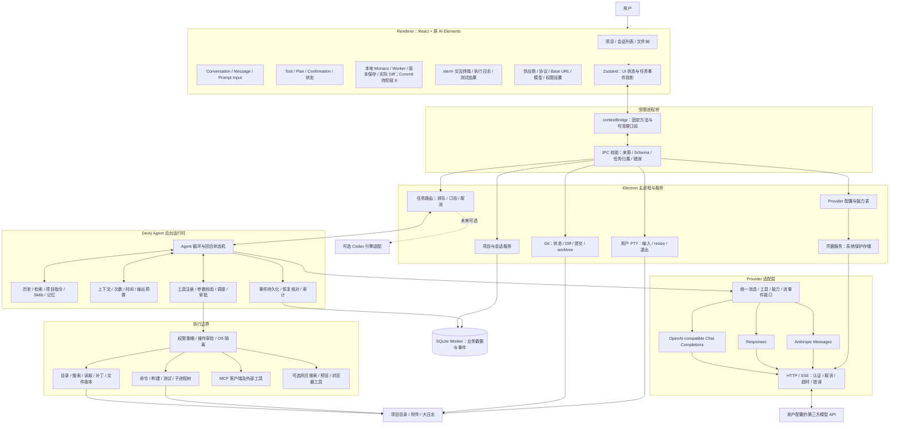
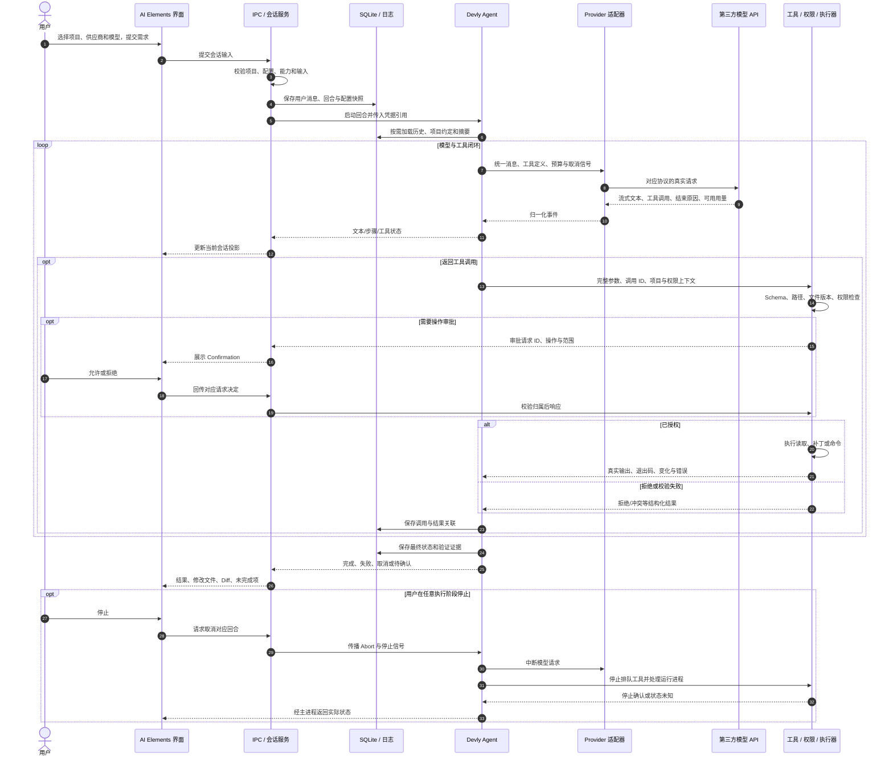
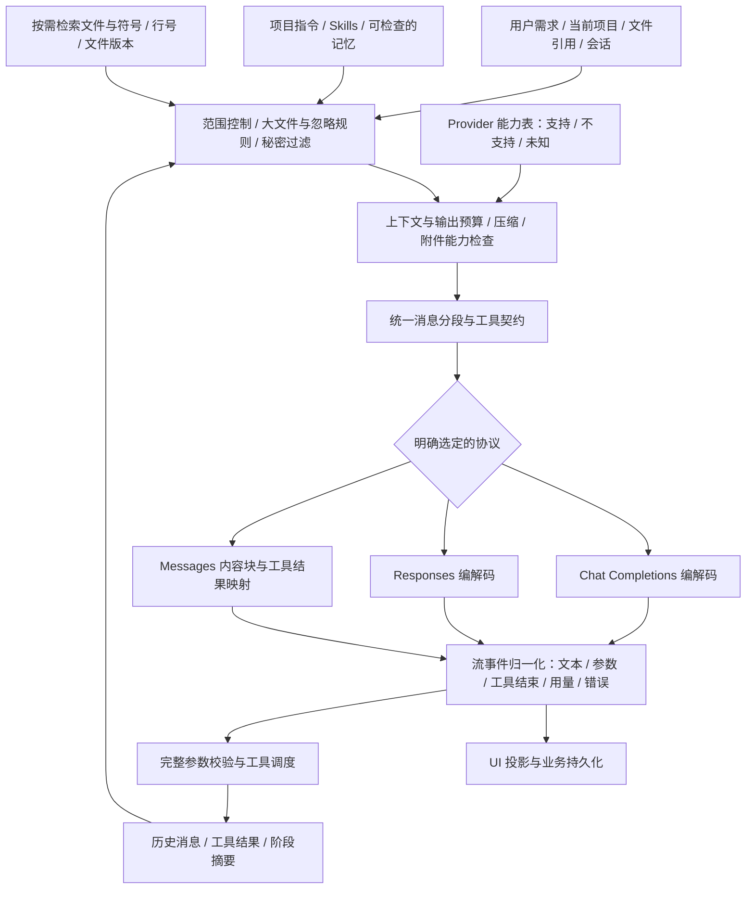
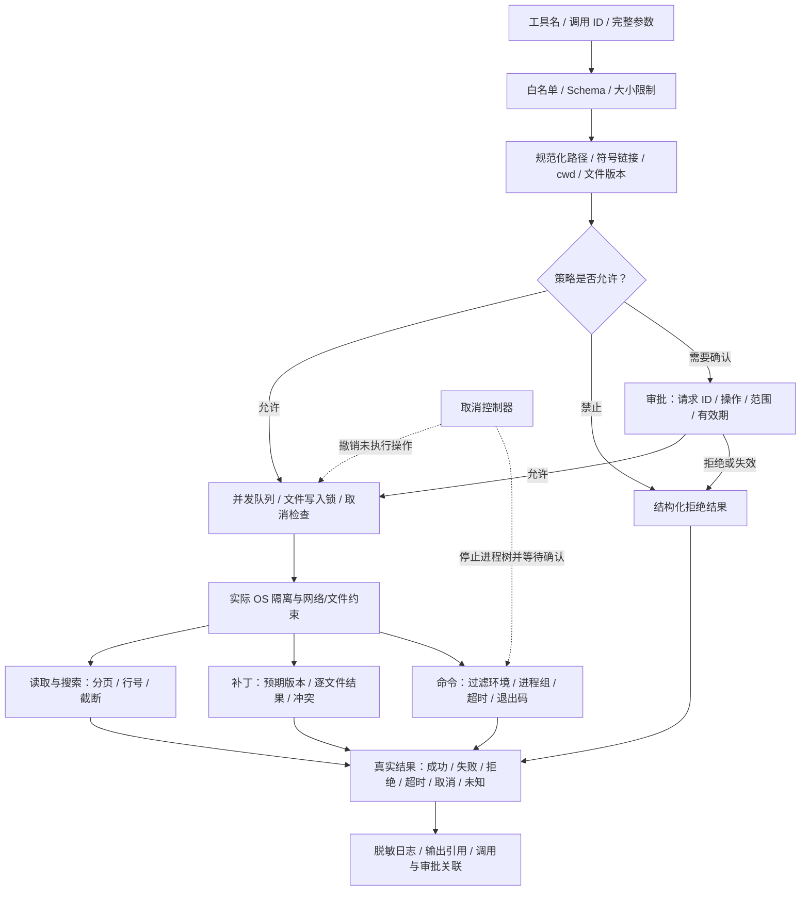
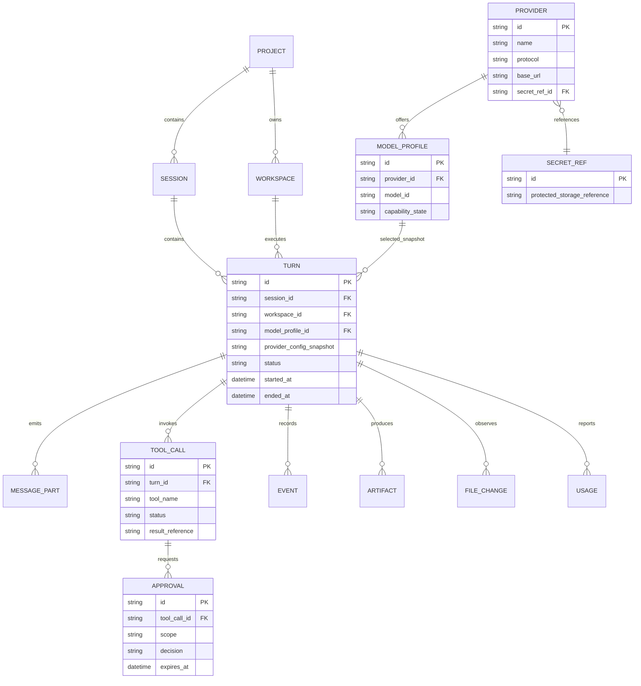
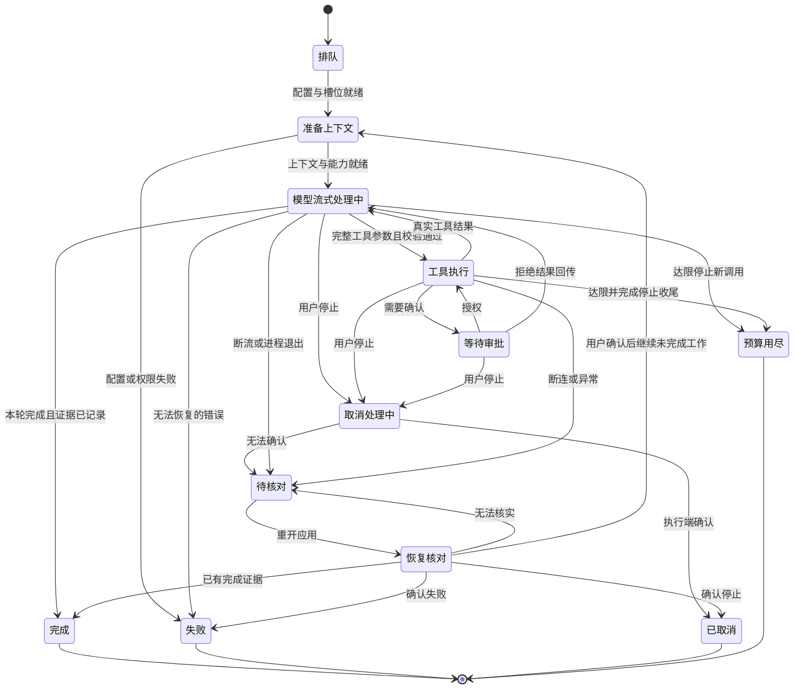

# Devly 当前架构：第三方 API 与本地 Agent

本架构按用户最新目标设计：做一个具备 Codex 类似功能、可直接接第三方 API 的桌面 AI 编程工具。当前已实现本地数据、会话/消息持久化、设置、Chat Completions、普通聊天与只读 Agent；阶段 6 接入 macOS 隔离写入、命令与逐次审批，阶段 7 接入文件树、本地 Monaco/Worker、版本保存与实际 Diff，并完成指定真实模型的编程样例。交互终端、跨重启继续仍为后续目标。实际状态以 [工作总表](./work-plan.md) 为准，已落地的 Provider 数据流见 [Provider API](./provider-api.md)。

旧的 Codex App Server 优先方案保存在 [历史架构](./archive/codex-app-server-architecture.md)，不再作为主路线。它的初始化握手验证可保留，但不等于自研 Agent 已经实现。

## 1. 技术和责任边界

- Electron + React + TypeScript，采用用户指定的原 AI Elements 及配套 shadcn/ui、Tailwind CSS、Lucide、Zustand。
- Devly 自己管理会话、上下文、模型/工具循环、审批、取消、恢复、预算与本地执行。
- Provider 适配器负责第三方 API 的请求、流、工具格式、错误和用量映射。先实现 Chat Completions 兼容协议，再做 Responses 与 Anthropic 原生适配。
- 供应商地址、Key 和模型可配置；Key 只由主进程或受控后台持有。数据库保存凭据引用，网络调用不放在 Renderer。
- Codex App Server 是可选引擎适配，不是使用前提；UI 不绑定它的 threadId、工具事件或认证。

## 2. 总体架构

箭头表示职责依赖，不表示各服务共用一个进程。数据库同步访问在 Worker 中，Agent 长任务在后台执行；权限校验不能只依赖 Renderer 的按钮状态。模型网络凭据与命令环境分开管理，执行命令时不得自动继承所有 API Key。

## 3. 一次真实编程任务的时序

停止分支代表运行期间可发出的控制，不是任务完成后才停止。断流不能证明工具未执行，不允许自动重复写入或命令。模型提出工具调用，实际应用执行并回传结果，这是客户端工具调用的基础机制。[OpenAI 工具调用](https://developers.openai.com/api/docs/guides/function-calling)、[Claude 工具调用](https://platform.claude.com/docs/en/agents-and-tools/tool-use/overview)

## 4. Provider 与上下文架构

能力表按端点、协议和模型验证；不支持工具调用的模型只能获得已验证的聊天能力。服务商不提供模型列表时允许手工模型 ID，不因此拒绝所有连接。未经用户操作不切供应商，也不把旧会话代码自动发送给其他端点。

## 5. 工具与执行边界

cwd 与 worktree 不是安全沙箱；Renderer 的 Chromium sandbox 也不能隔离主进程启动的任意 shell。写操作需要实际的文件一致性检查，跨文件补丁可能部分成功。操作系统隔离能力须按 macOS/Windows 分别验证，不用关键词黑名单代替隔离。

## 6. 自有数据模型

这是目标逻辑模型；阶段 2 的 v1/v2 迁移已覆盖项目、配置、会话、消息/工具/事件等基础实体，阶段 3 的 v3 增加 Provider 兼容配置、版本和检查证据，阶段 4 的 v4 增加会话模型绑定和实际回合/消息生命周期，Agent 上下文/执行恢复仍待后续。API Key 不存在 Provider 或消息表里，SECRET_REF 只保存保护存储引用。用量缺失与零区分，费用未知不编造。消息和事件以 Devly ID 为主，外部模型/可选引擎 ID 只是关联字段。原始大日志与附件落盘，SQLite 保存索引；外框截图等本机产物不等于云端历史。阶段 3 的实际数据流、生命周期与验证边界见 [Provider API](./provider-api.md)。

## 7. 任务状态与恢复

直接 API 请求与本机进程通常不能在应用重启后无条件续接。恢复必须依据已存事件、工具执行结果和当前文件重新核对；“继续”不是重放全部历史操作。状态机聚合回合状态，各个并行工具仍有自己的独立状态。

## 8. 对应实施文档

- [技术选型](./tech-stack.md)：已安装与待增加的依赖、进程归属。
- [阶段计划](./development-plan.md)：可用节点和交付范围。
- [工作总表](./work-plan.md)：逐项任务、依赖与验收。
- [工作日志](./work-log.md)：已完成事项和证据。
- [编辑器与实际 Diff](./editor-and-diff.md)：文件服务、监听归属、本地资源、缓冲区与保存/差异责任图。

阶段 4 实际架构、数据库 v4、回合状态、模型切换授权与局部消息 ScrollArea 见 [普通聊天说明](./chat.md)。这是普通聊天的实际数据流；阶段 6 的工具/审批/执行数据流另见下文和执行说明。

## 已实现的用量与额度路径

设置的独立用量分类通过严格 IPC 在数据库 Worker 聚合 turns.usage，v7 provider_usage_budgets 保存本地预算与计数起点；账户余额查询由 Main 按实际配置域名选择已实现的适配器并读取 Vault，不根据模型品牌跨站发送 Key。当前仅 DeepSeek 官方金额余额可手动查询，其他平台明确显示未接入；详情与数据流见 [用量与额度](./usage-and-budget.md)。

## 阶段 6 执行与审批数据流

普通聊天仍不提供工具；只读模式保留三个只读工具。项目 Agent 只有在 macOS、本地项目、ask 策略和实际系统预检通过时，增加 update_plan/apply_patch/run_command。详细责任图、审批/取消/隔离边界见 [执行与审批](./execution-foundation.md)，任务与最终验证见 LOG-047 和工作计划。

Main 接收固定作用域请求，准备 Provider/上下文/Git 基线，运行模型与工具循环。完整参数校验后先保存工具和审批元数据到 SQLite Worker v8，由原 Confirmation 提交对应 ID/digest 的单次决定。拒绝作为工具结果回传；允许后进入全局单修改队列，固定补丁助手和前台命令分别在 deny-default Seatbelt 内运行。只读 Git 基线也不能通过配置/过滤器写文件或联网。系统约束不可用则失败，不降为普通主机 shell。

运行时计划要求已完成项关联成功调用；原 Plan/Task 只投影这些计划和真实记录。日志先脱敏再落盘/返回；上下文估算与供应商实际 Token 分开显示，未知费用不估价。停止贯穿网络、队列、审批、受管进程组与收尾持久化；确认失败显示状态未知。异常重启使旧审批失效，不自动续跑；脱组后台进程、外置 worktree 元数据、个人工具链与 Windows 的剩余边界明确列出。

阶段 7 增加 EditorService，复用 ReadOnlyToolbox 的范围、忽略、大小/编码和内容保护；手工保存与 Agent 补丁共用串行队列/隔离助手，模型操作仍逐次审批。监听 lease 绑定窗口 owner/watch UUID；Renderer 仅存项目 UUID+路径的有界缓冲区，正常离开询问，崩溃恢复尚未实现。Git 只读状态/HEAD 内容进入 Monaco Diff，未保存比较与实际磁盘 Diff 分开显示。五类 Worker 由本地打包资源提供，不访问 CDN；详见编辑器说明与 LOG-050/LOG-051。
