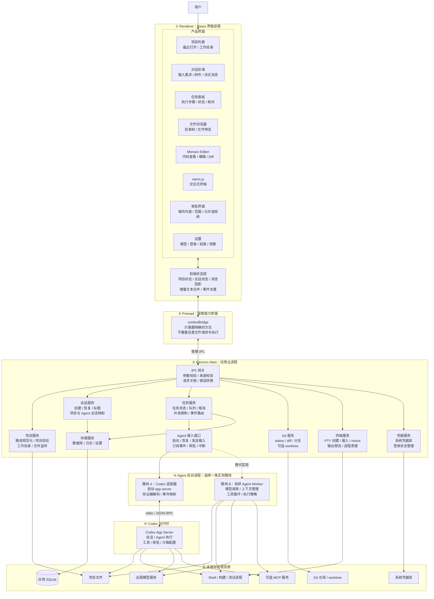
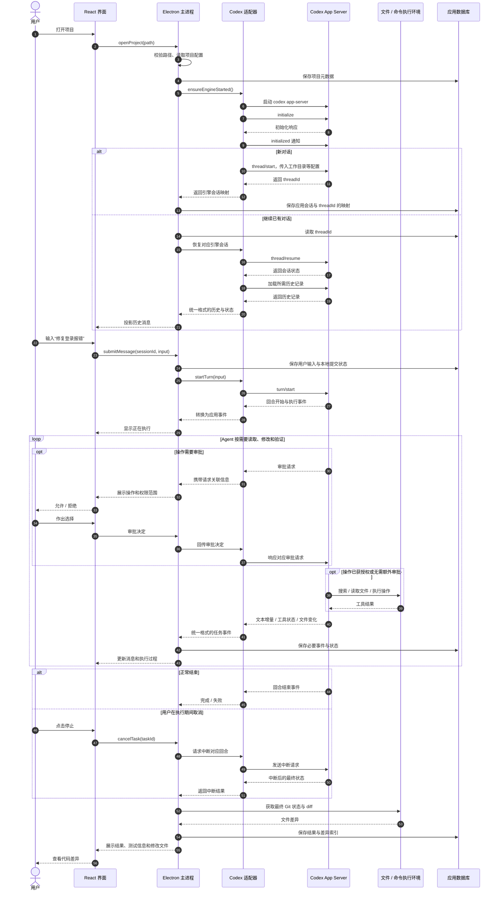
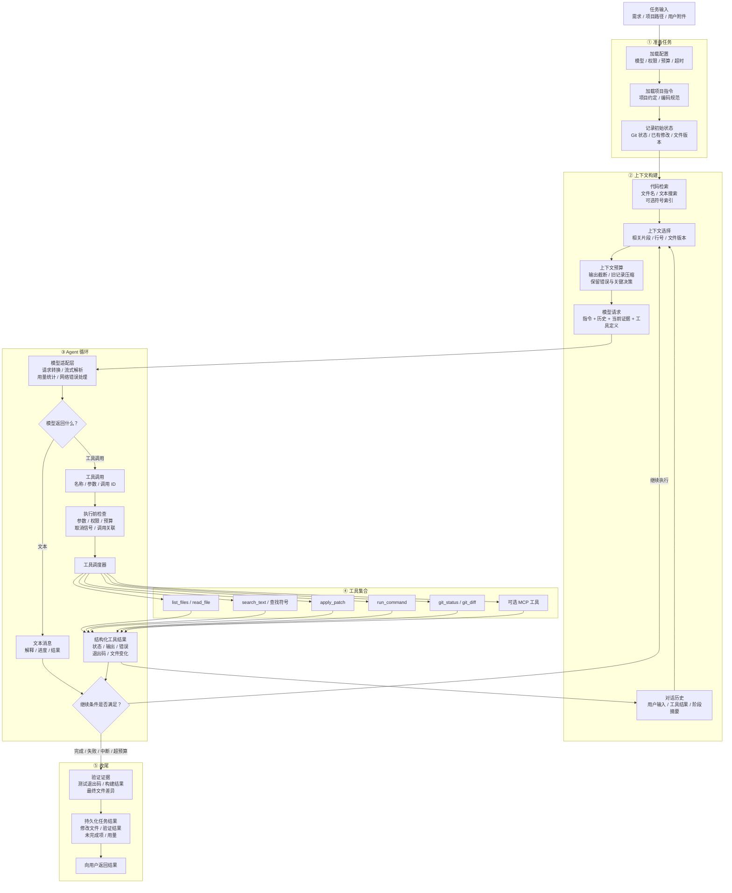
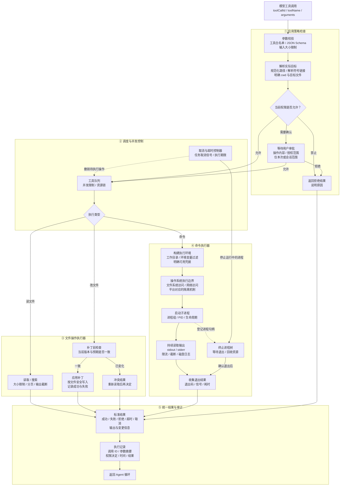
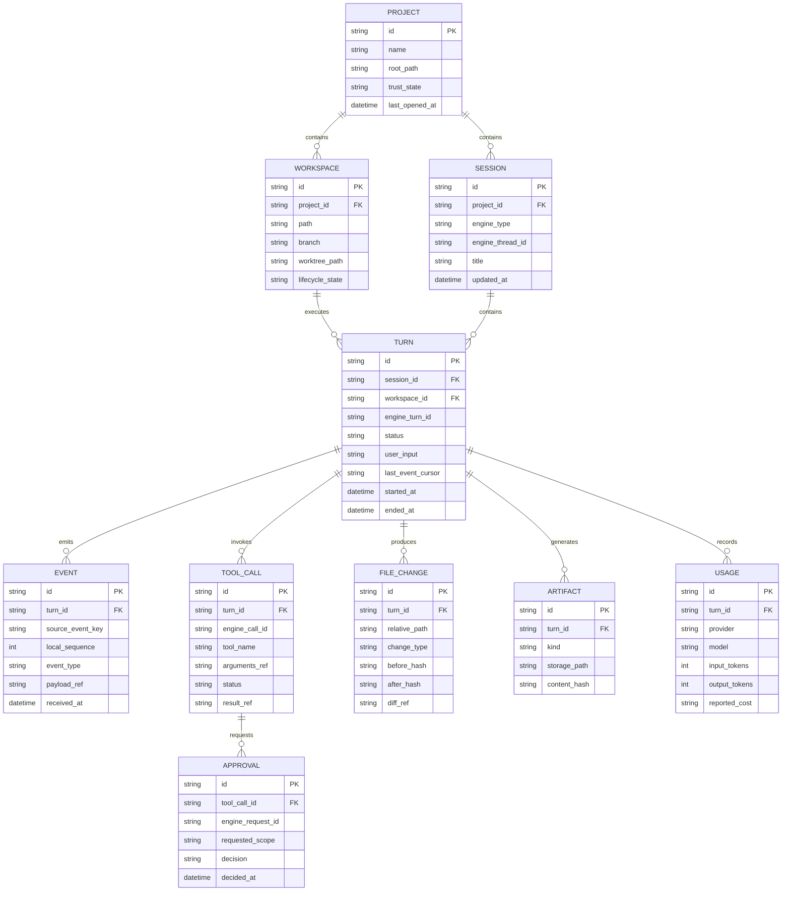
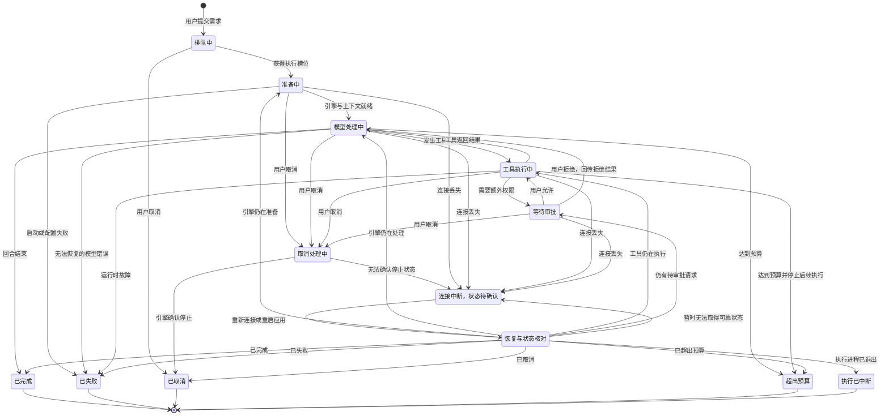

# 历史方案：Codex App Server 优先路线

> 本文为目标澄清前的历史快照，已由当前文档替代，不作为后续执行依据。

# Devly 详细架构设计

本文描述一个能实际开发和维护的桌面编程助手，覆盖六个视角：总体架构、Codex 接入时序、自研 Agent、工具执行边界、数据存储和任务状态。

这是建议采用的工程设计，其中 Codex 接入部分依据官方协议；其他模块是 Devly 自己的产品实现方案。图中模块代表设计职责，不代表当前仓库已经实现这些功能，也不代表 Codex 内部源码的精确结构。

## 目录

1. [实现路线与技术选择](#1-实现路线与技术选择)
2. [总体架构](#2-总体架构)
3. [Codex 接入时序](#3-codex-接入时序)
4. [自研 Agent 执行架构](#4-自研-agent-执行架构)
5. [工具执行权限与沙箱边界](#5-工具执行权限与沙箱边界)
6. [数据架构与存储归属](#6-数据架构与存储归属)
7. [任务状态机与恢复](#7-任务状态机与恢复)
8. [首版实现范围与验收](#8-首版实现范围与验收)
9. [官方参考资料](#9-官方参考资料)

## 1. 实现路线与技术选择

首版建议使用 **Electron + React + TypeScript + Codex App Server**，跑通“读代码 → 修改 → 执行测试 → 查看差异”的完整流程，不需要自己训练大模型。具体库、组件实现和进程归属见 [技术选型与实现方式](../tech-stack.md)。

| 路线 | Devly 负责的内容 | 适合的目标 |
| --- | --- | --- |
| A：接入 Codex App Server | 桌面界面、项目管理、协议适配、交互和差异展示 | 尽快做出接近 Codex 的软件 |
| B：自研 Agent，接入模型 API | 上述功能，加工具执行、上下文管理、权限和任务循环 | 支持多家模型，深度定制行为 |

两条路线是 Agent 引擎的替代实现。产品层通过统一接口调用引擎；首版可以只实现路线 A，后续按实际需要扩展路线 B。

官方将 App Server 定位为自定义 Codex 客户端的接入方式，支持认证、会话历史、审批和流式事件；Codex SDK 更偏向编程任务自动化。[官方接入说明](https://learn.chatgpt.com/docs/codex-sdk)

| 模块 | 建议技术或实现方式 |
| --- | --- |
| 桌面应用 | Electron + TypeScript |
| 界面与构建 | React + electron-vite |
| 通用 UI | 使用 AI Elements 配套的 shadcn/ui 基础组件，基础组件版本与所选 AI Elements 源码保持一致 |
| AI 专用 UI | 采用用户指定的 elements.ai-sdk.dev 这套 AI Elements，包括原 Commit 组件，适配 Codex 事件与业务状态 |
| 样式与主题 | Tailwind CSS + CSS 变量 |
| 图标 | lucide-react |
| 前端状态 | Zustand |
| 代码与差异展示 | Monaco Editor |
| 交互式终端 | xterm.js + node-pty |
| 本地数据 | SQLite，保存项目、会话索引和设置 |
| Git | 调用 Git CLI，获取状态、diff 和 worktree |
| Agent 通信 | 首版使用 App Server 的 stdio 协议 |

文件访问、进程启动和凭据管理放在主进程或受控后台进程，界面通过受限 IPC 调用。

## 2. 总体架构

界面负责交互，主进程负责系统能力，Agent 放在独立进程中运行。



### 关键边界

- **Renderer 不直接访问文件、凭据或启动进程**，统一通过受限 IPC。
- **Codex 路线和自研路线是两种引擎实现**，产品层使用统一接口。
- **用户交互终端与 Agent 命令执行分别管理**，各自拥有明确的进程、工作目录和生命周期。
- Codex 适配器负责协议和事件映射；Codex App Server 是独立运行时。适配器本身不一定需要额外启动一个操作系统进程。
- 图中自研 Agent 到资源的连线表示能力依赖；实际访问必须经过第 5 节的工具调度、权限检查和执行边界。

## 3. Codex 接入时序

这条路线中，Devly 负责客户端和协议适配，代码理解与执行交给 Codex。

主进程启动以下命令，并管理子进程的输入、输出、错误和退出状态：

```bash
codex app-server
```



### 协议与事件处理

`initialize → initialized → thread/start 或 thread/resume → turn/start` 是官方协议的基本接入流程，默认 stdio 使用逐行 JSON。[App Server 协议文档](https://learn.chatgpt.com/docs/app-server)

- 按请求 ID 匹配响应，持续处理服务端通知与服务端发起的请求。
- 审批结果必须关联到对应的引擎请求，不能仅靠前端当前选中的任务判断归属。
- 客户端收到工具事件时负责展示；采用 Codex 路线时，不要再把同一事件当成指令重复执行。
- 文本增量可以合并渲染；审批、错误、工具完成和回合结束等状态事件必须保持顺序和归属。
- 需要处理进程退出、协议异常、取消任务、恢复会话，以及“执行中、等待审批、失败、完成”等状态。
- 图中的取消分支是对执行期间用户中断的简化表示，实际实现应允许在执行过程中的任意可中断阶段发出请求。

## 4. 自研 Agent 执行架构

如果以后需要支持多家模型，可以实现自己的运行时。以下整块替换 Codex 引擎，桌面产品层继续复用。



### 核心职责

模型负责选择工具，程序负责执行并将结果交回模型，这个循环就是工具调用的基础机制。[Function Calling 官方说明](https://developers.openai.com/api/docs/guides/function-calling)

第一版工具可以控制在以下范围；这些是 Devly 的建议接口，不是 Codex App Server 协议方法：

```ts
list_files(path)
search_text(pattern, path)
read_file(path, startLine, endLine)
apply_patch(patch)
run_command(command, cwd, timeout)
git_status()
git_diff()
```

需要承担的工程职责包括：

- **上下文管理**：按需搜索和读取文件，控制日志长度，给长任务生成摘要。
- **执行边界**：限制工作目录、网络和文件访问；命令需要超时、取消以及进程树清理。
- **修改一致性**：应用补丁前检查文件版本，避免覆盖用户正在编辑的内容。
- **恢复能力**：保存工具调用和任务状态，区分已完成的操作与尚未执行的操作。
- **成本控制**：设置每个任务的调用次数、Token 或费用预算。

Git 状态、测试退出码和文件内容是执行证据，模型生成的“已成功”只是一段文本。没有实际执行验证时，应明确记录未验证。

## 5. 工具执行权限与沙箱边界

这一层决定软件能否可靠地操作本地项目。以下是自研执行器的设计；使用 Codex 时，应由适配器配置、接入 Codex 已有的权限和执行机制。



### 边界说明

- **worktree 用来隔离代码修改，不是安全沙箱。**
- **路径校验约束文件工具；Shell 的文件和网络访问还需要操作系统层的执行边界。**
- **取消任务不会自动撤销已经写入的文件。** 界面应保留已有 diff，供用户检查。
- 权限审批必须发生在对应的受控操作执行之前；拒绝后把拒绝结果返回 Agent，由 Agent 决定是否采用其他方法。
- 工作目录只指定命令在哪里开始运行，不会天然禁止它访问其他目录。
- 环境变量和输出日志可能包含凭据，保存执行记录时需要限制采集范围并处理敏感值。
- 多文件补丁可能部分成功，必须记录每个文件的真实结果；不能默认整批修改具备事务回滚能力。
- 图中的路径检查与文件版本检查属于应用层约束；存在并发访问时，仍需通过实际文件操作和系统隔离机制落实边界。

## 6. 数据架构与存储归属

把应用自己的元数据和引擎拥有的会话数据分开管理。下图是建议的逻辑数据模型，不是已实现的数据库迁移。



### 存储分配

| 数据 | 建议存放位置 | 负责方 |
| --- | --- | --- |
| 项目、设置、会话映射 | 应用 SQLite | Devly 客户端 |
| Codex 会话历史和执行状态 | Codex 自身管理的存储 | Codex；通过协议读取 |
| 自研 Agent 完整历史 | 应用数据库及日志文件 | Devly 运行时 |
| 界面消息、工具状态 | 前端内存；必要时缓存 | 由引擎事件重建 |
| 大段命令日志、截图等 | 文件系统，数据库保存索引 | 应用或执行器 |
| 密钥、令牌 | 系统凭据库或引擎认证机制 | 对应认证模块 |
| 项目文件、Git 对象 | 项目目录和 Git 仓库 | 文件系统与 Git |

### 一致性与恢复原则

- 图中的工具和审批记录，在 Codex 路线下可以是用于界面展示的本地投影。恢复时应与引擎重新对齐，不能仅凭本地缓存推断操作仍在运行。
- `engine_thread_id`、`engine_turn_id`、`engine_call_id` 和 `engine_request_id` 分别关联引擎对象，避免把不同会话或任务的事件混在一起。
- `local_sequence` 用于应用内部的事件排序；`source_event_key` 和 `last_event_cursor` 应根据接入协议的实际能力设计，不假定引擎支持任意事件重放。
- `FILE_CHANGE` 保存差异信息，不代表具备完整回滚能力；要支持恢复文件，还需要保存相应内容或可靠快照。
- 用量和费用字段以引擎或服务商实际返回的信息为准；未提供的值应允许为空，不把缺失值当作零。
- 快照和差异展示必须考虑任务开始前已有的用户修改，避免把用户原有改动全部归因于 Agent。

## 7. 任务状态机与恢复

建议以一次用户提交对应的回合作为基本执行单位。应用可以在此之上增加更高层的任务，但两者应保留明确的关联。



### 恢复规则

连接中断不等于任务失败，也不等于工具没有执行。恢复时先查询引擎状态、核对文件和进程，再决定是否继续；不能自动重放修改文件、安装依赖、提交代码等有副作用的操作。

- 点击“停止”后先进入取消处理中，收到引擎或执行器的停止确认后再显示已取消。
- 无法确认进程状态时进入状态待确认，不向用户承诺任务已经停止。
- “已完成”表示回合执行结束；需求是否实现、测试是否通过，需要结合验证结果判断。
- 超出预算后停止发起新的模型或工具调用；正在运行的操作需要完成收尾或确认停止，才能把回合持久化为最终状态。
- 状态机中的“工具执行中”是回合层面的聚合状态。单个工具调用仍应保留独立状态，以支持并行工具和部分失败。
- 自动重试应区分只读查询与有副作用的操作。网络错误不能作为重复执行写入或命令的充分理由。

## 8. 首版实现范围与验收

详细开发顺序、阶段产物和完成条件见 [开发阶段与交付计划](../development-plan.md)。下列链路是 MVP 核心范围；完整 1.0 还包括计划中列出的终端、恢复、多任务与集成、安装包验证。

首版优先完成以下链路：

**项目选择 → Codex 进程管理 → 会话创建与恢复 → 流式事件 → 审批与取消 → Git diff → 重启后状态恢复。**

### 建议开发顺序

1. 实现项目选择、聊天界面和设置页。
2. 接通 App Server，显示真实的流式消息和执行事件。
3. 加入审批、取消、错误提示和会话恢复。
4. 加入文件查看、Git diff 和测试结果展示。
5. 再扩展多任务、独立 worktree、MCP、Skills 和其他模型。

### 核心验收场景

用户打开一个 Git 项目，输入“修复这个报错”，AI 找到相关文件、修改代码、执行测试，用户能查看完整 diff；应用重启后还能继续会话。

验证时至少覆盖：

- 新建会话与恢复会话能够关联到正确项目和工作目录。
- 文本和工具事件持续更新，完成、失败和等待审批状态清晰可见。
- 审批允许或拒绝后，只影响对应操作。
- 取消后能够确认执行状态，并保留已有文件差异。
- 应用断连或重启后不会自动重复执行已经发生的写入和命令。
- 原有用户修改不会被覆盖或误归因为 Agent 新增修改。

## 9. 官方参考资料

- [Codex App Server](https://learn.chatgpt.com/docs/app-server)：自定义客户端、协议初始化、会话、回合、事件与审批。
- [Codex SDK](https://learn.chatgpt.com/docs/codex-sdk)：编程任务自动化与 SDK 接入定位。
- [Function Calling](https://developers.openai.com/api/docs/guides/function-calling)：模型工具调用与应用执行循环。

外部协议、字段和实验能力可能随版本变化。实现适配器时应选择明确的运行时版本，并以对应官方协议和能力协商结果为准。
