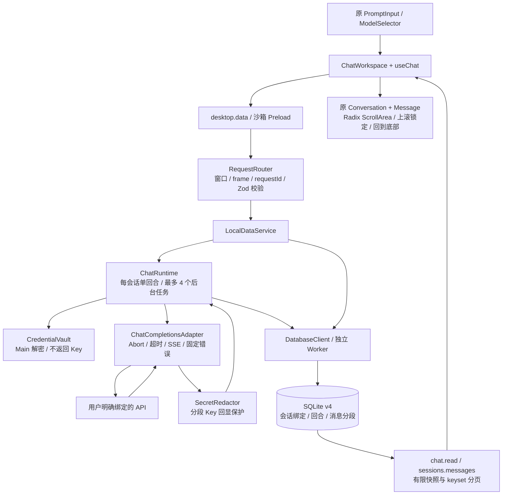
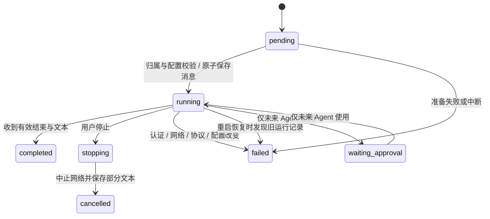

# 阶段 4：普通聊天与历史恢复

更新：2026-11-22。对应 4.1/P07、4.2/A01、4.3/U01、4.4/U02，记录见 LOG-036–LOG-039。代码和本地端到端检查已落地；真实供应商验收与包内结果分别记录，不把测试服务当作模型接通。

## 使用流程

1. 在设置中保存 Chat Completions 供应商、模型和受保护的 API Key。密钥仍通过 Main 的系统输入框设置，不进入 Renderer。
2. 打开本地项目，选择模型，在任务输入框输入文字；Enter 发送，Shift+Enter 换行，中文输入法组合期间不会提交，空输入不能提交。
3. 首次发送会创建项目会话，保存用户消息与回复占位后再发 HTTP 请求。输入框在当前会话生成时锁定，按钮变为停止；其他会话可继续使用。
4. 可切换项目、会话或设置页；原会话在 Main 继续接收，回来后读取同一回合。页面刷新不会重发请求。正常退出会停止并保存；异常退出后标记中断，由用户决定重发。
5. 重启应用后选择原会话即可继续。只有成功完成的历史回合进入下一条请求；取消/失败的部分回复保留显示，可明确重新发送。附件入口当前禁用，拖入/粘贴文件会提示仅支持纯文本，不偷偷上传本地文件。

本阶段只发送用户输入和该会话已完成的对话历史，**不自动读取项目目录、项目约定、文件或工具结果**。选择项目用于本地归属。完整上下文组装、工具调用循环、审批和命令执行属于后续阶段。

## 会话与模型规则（P07）

应用/项目默认模型是新会话的初始值；已有会话使用自己的 providerId/model，不随默认设置改变而跳到其他端点。旧版本未绑定的会话要求明确选择模型，不自动猜测迁移。

有消息的会话切换模型时，界面提供三种结果：

| 操作 | 历史与网络行为 |
| --- | --- |
| 取消 | 原绑定保持不变 |
| 新建会话使用 | 新会话为空，原会话及其绑定保留 |
| 保留历史并切换 | 明确授权当前会话的已完成历史在下一次发送时交给所选供应商 |

切换操作自身不会发 API 请求；生成中拒绝修改绑定。服务端再次检查 allowHistory，不能绕过弹窗直接更换已有历史的绑定。每个回合记录实际 Provider UUID、模型和配置 revision，旧回合不随会话切换改写；删除供应商后不自动替换成另一家。

## 实际架构



回合属于 Main 与数据库，不属于某个 React 页面订阅。useChat 仅为可见会话轮询快照，卸载会停止定时器、丢弃迟到结果，不取消后台生成，也不把结果写到新的会话。发送已被接受后，即使 UI 刷新失败也不自动重复提交。较早的轮询不能覆盖较新已接受的回合。

## 本地契约

| 操作 | 参数与行为 |
| --- | --- |
| sessions.bind | projectId/sessionId/providerId/model；allowHistory 默认为 false；setDefault 为 true 时，会话绑定和项目默认模型在同一事务保存，其他设置保留 |
| chat.start | projectId/sessionId/turnId/text/expectedProviderId/expectedModel；Main 拒绝界面所见模型与持久化绑定不一致的请求，再复核配置 revision，避免旧界面意外发送给另一供应商 |
| chat.read | projectId/sessionId；仅返回最新回合 DTO 与安全文本，不返回 Key/凭据引用 |
| chat.cancel | projectId/sessionId/turnId；只停止对应回合，旧 turnId 不会取消新回合 |
| sessions.messages | 按项目/会话配对读取消息分段、状态与实际用量，limit/cursor 有界 |

## 生命周期（A01）



持久化 status 保持 pending/running/completed/failed/cancelled；phase 能表达 stopping 和预留的 waiting_approval。状态转换在共享契约定义、Worker 再校验；终态不能重新变回 running。工具状态契约仅预留，不创建假工具、审批、计划、测试或用量。未提供工具的普通请求若意外收到工具调用，显示不支持且不执行。

- 运行期由 AbortController 中止 fetch/SSE；120 秒超时，不自动切供应商或重试。
- 保存/删除 Provider 或替换/清除凭据会中止原配置请求；发请求前按 revision 检查准备期间的配置变化。
- 项目移除、会话归档先停止关联生成，再改变可见状态；不删除项目目录。
- 正常退出等待任务终结再关闭 Worker；重启把旧运行回合标为 INTERRUPTED，保留此前保存内容，不重复执行。
- 401/403/429/5xx/断流/超时等沿用 Provider 固定错误。Key 读取失败在发 HTTP 前拒绝，不能把它标成 API 的 401。

## 数据与边界

v4 是事务迁移：sessions 新增 provider_id/model；turns 增加实际绑定/revision、用户/助手消息 ID、phase、时间、error、usage 和 finish。旧 v3 数据保留，旧运行记录先恢复为失败，再建立每会话最多一个活动回合的唯一索引。升级前仍备份，失败回滚，不删旧库。

开始时在一个事务内写回合、用户消息、助手占位和两个 text 分段；此后约 80ms 批次保存累计安全文本，结束时再保存完整结果。进程突发中断可能丢失最后尚未提交的片段，界面不会把部分回复当成完整成功。

| 边界 | 当前实现 |
| --- | --- |
| 输入 | 最多 32,768 字符，去掉首尾空白后不能空 |
| 上下文 | 最多 200 条成功回合的消息，序列化后最多 256 KiB；超过时明确要求新建会话，不静默截断 |
| 单条回复 | 最多 262,144 字符；适配器另有 2 MiB 响应体限额 |
| Token/费用 | 输出参数采用当前项目 maxTokens；未上报用量保持 null；费用不编造，maxCost 尚不是完整 Agent 成本预算 |
| 历史 | UI 首次读最新 20 条，按需向前翻页，(created_at,id) 游标避免重复；本地附件/大日志仍按既有索引分段读取 |
| 传输 | 只有本地 DTO，Main 不序列化原始供应商错误体、Key 或 Authorization |

原版 Conversation 的底部跟随逻辑与同源 ScrollArea 组合，不修改上游源文件。消息区是局部滚动，外层页面不增高；加载更早消息保留阅读位置，主动上滚或使用向上翻页键会明确停止跟随，回到底部按钮恢复跟随。

## 检查与验收

```bash
pnpm check
pnpm verify:chat-ui
pnpm run pack --config.mac.identity=null
DEVLY_EXECUTABLE=release/mac-arm64/Devly.app/Contents/MacOS/Devly pnpm verify:chat-ui
```

verify:chat 已纳入 check，使用真实 Electron ABI/SQLite Worker、注入 HTTP 响应与受保护引用替身，检查回合原子性、归属/取消、历史授权、错误、Key 分片回显保护、分页、重启和迁移。verify:chat-ui 使用实际 Electron 和 loopback HTTP，不使用用户 Key，检查真实输入/流式/切换/取消/分页/滚动/恢复。它们都是本地验证。

本轮另尝试在隔离资料目录复用已保存的 DeepSeek 密文，结果为 CREDENTIAL，随后聊天准备未被接受；未取得真实端点响应。原资料未迁移或改写，未输出密钥；不将密文复制当作系统保护跨构建/配置可用的承诺。该一次性检查不纳入产品/CI。真实验收仍需在正常 Devly 资料与系统授权下完成：

- [ ] 选择有效 Provider/模型发送文字，收到真实文本流。
- [ ] 退出重启，原消息仍在，继续发送并正确采用此前完成的历史。
- [ ] 在工作日志只记录协议、模型、时间和结果，不记录 Key、Authorization 或带秘密的 URL。

未完成真实验收前阶段 4 保留“待验证”；阶段 3 的真实文本/流式/工具检查也不因本地聊天实现而自动通过。Windows、远端 CI、签名和发行仍单独验收。
