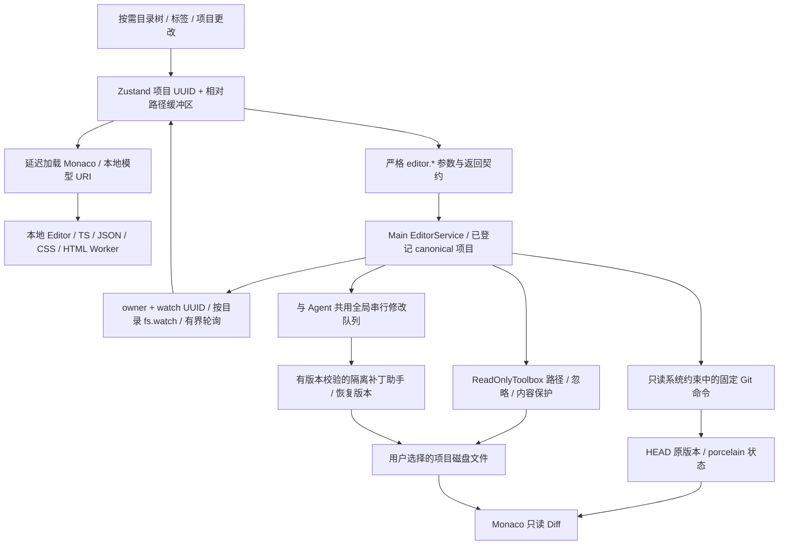

# 阶段 7：本地文件、Monaco 与实际 Diff

任务 G01/G03/G04/G05/A09；验收状态以 [工作计划](./work-plan.md) 和 [工作日志](./work-log.md) 为准。编辑器复用已安装的 Monaco 0.52.2、@monaco-editor/react 4.7.0；没有替换原 AI Elements 或新增另一套基础 UI。

## 使用方式

打开本地项目后，页头的“项目文件”和“项目更改”展开工作区，右侧聊天保持可用。目录按需展开、每页 100 项；文件标签保留当前进程中的编辑内容，带圆点表示未保存。最多打开 20 个文件，达到上限需先保存或关闭。分隔线可调整文件区与聊天、文件列表与编辑器的空间；布局持久化属于阶段 8/U08。

- “保存”或 Command+S：提交当前文件的完整内容与打开时 SHA-256。只有实际写入、重新读取内容一致才显示保存完成。
- “比较未保存”：打开时版本 → 当前内存内容，不写入磁盘。
- “Git Diff”：HEAD → 当前磁盘，明确不包含未保存草稿。
- 外部编辑时：干净缓冲区重新读取；有未保存内容则保留草稿，显示冲突和“比较外部更改”。保存仍会再次校验版本。
- 关闭脏标签、重新载入：提供继续编辑、放弃内容、保存后操作。窗口关闭/应用退出有原生离开确认；取消后数据库与应用继续可用，已开始的保存等收尾后才关闭存储。
- 切换项目、设置、隐藏文件区不会主动丢弃内存缓冲区。草稿没有写入恢复数据库，异常退出可能丢失，不能当作 R02 跨重启恢复。

Agent 的读取和补丁记录可定位文件或实际 Diff；命令卡可打开项目更改。记录中的路径只是受校验的项目相对路径，不能成为任意磁盘读取入口。文件监听在文件工作区展开时工作，重新展开会立即刷新。

## 数据流与归属



| 操作           | 参数要点                               | 返回与处理                                              |
| -------------- | -------------------------------------- | ------------------------------------------------------- |
| editor.list    | projectId、path、offset                | 单目录最多 100 个 entry、nextOffset；不递归加载全项目   |
| editor.read    | projectId、path                        | 完整受限 UTF-8 文本、精确版本、字节数，或明确不支持状态 |
| editor.save    | projectId、path、expectedHash、content | saved、重新读取的 document、error、必要时 recoveryPath  |
| editor.observe | projectId、watchId、最多 64 个目录     | revision、实际 watching 数、degraded                    |
| editor.release | watchId                                | 仅释放当前窗口 owner 的监听                             |
| editor.changes | projectId                              | 有界变化列表、截断标记、非仓库/不可用原因               |
| editor.diff    | projectId、path                        | original、modified、oldPath、HEAD 基线与可用性          |

现有 RequestRouter 校验来源、请求归属和严格 Schema；EditorService 再检查项目在 Repository 中登记、非托管通用聊天目录、根路径与 canonical realpath 一致。数据库只查项目元数据，本阶段不增加迁移。文件模型 URI 为 `devly://项目UUID/逐段编码路径`，跨项目同名文件不会共用内容。

## 文件、监听与保存边界

复用只读工具的忽略规则、默认大目录排除、敏感路径/内容检测和符号链接拒绝策略。读取完整文件最多 256 KiB；二进制、无效 UTF-8、超限、删除、受保护文件各有明确表现，不自动转换编码。BOM 保留在版本摘要与保存内容中，编辑器显示层不把 BOM 当可见文字；CRLF 按当前模型保存。

监听只覆盖根目录、展开目录与已打开文件的父目录，不递归扫描用户目录。变更 80ms 合并，通过约 1 秒轮询 revision 刷新；约 5 次轮询进行一次兜底刷新，手动刷新始终可用。每 owner 最多 4 个 watch lease，请求目录最多 64 个，根目录纳入范围。目录 inode 改变会重建监听；删除/权限失效显示降级并继续刷新其余文件。卸载、窗口销毁与退出清理句柄；已释放 UUID 留有界标记，防止晚到 setup 重新创建监听。

手工“保存”来自用户主动操作，不经过模型审批；Main 仍执行相同路径、大小、编码、内容保护与版本检查，复用阶段 6 的串行修改队列和隔离补丁助手。模型调用 apply_patch 仍必须逐次审批，不能借编辑器绕过审批。保存过程中继续输入的内容保留为下一次草稿，旧 refresh 结果不能覆盖刚保存的版本。

版本检查不等于任意外部进程参与的原子 CAS。沿用阶段 6 恢复原 inode 的路径，非协作外部编辑和失败时应核对磁盘/恢复版本；不会把部分或未知结果说成成功。秘密检测沿用既有保护规则，不能保证识别任意未知秘密。当前 macOS 执行实现已接入；其他平台显示只读预览，写入与实际 Git 系统约束待阶段 12/T12 验证，没有无隔离降级。

## 本地资源、模型与语言服务

`monaco.ts` 将已导入的 Monaco 实例交给 loader，不访问默认 CDN。五类 Worker 用 Vite `?worker&inline`、IIFE 单包生成，运行于本地 blob，避免打包后 file:// Worker 的相对模块与跨源问题。构建产物与 asar 包含代码、CSS 和字体。JSON 远程 Schema 请求关闭。

EditorPane 延迟加载；当前含五类 Worker 的单块约 22.9 MB（未压缩），首次打开文件区有资源加载成本，后续可优化拆包。文件模型按项目/路径缓存、关闭后释放；Diff 使用实例独立 URI，先销毁 widget 再释放模型，避免旧 Diff 引用已经释放的文本模型。关闭 Monaco 0.52 的 occurrencesHighlight 自动同词高亮以避开其销毁时未处理的 Delayer 取消；类型诊断、语法着色、查找和编辑保留。

支持打开模型的基础 TS/JS 诊断和补全、JSON/CSS/HTML Worker 与其他已内置语言的语法着色。没有项目级 LSP、tsconfig/node_modules 自动读取、依赖安装或完整构建能力。TS Worker 自带类型不证明项目实际编译通过；真正测试仍由审批后的命令结果说明。

许可证：monaco-editor、@monaco-editor/react、@monaco-editor/loader 均 MIT；前两份从锁定安装包复制到构建 Resources/licenses，loader 固定副本在 resources/vendor/monaco-loader.LICENSE。原 AI Elements 仍沿用既有固定来源校验。

## Git Diff 范围

系统 Git 使用参数数组、literal pathspec、NUL porcelain、禁止可选锁、禁用 fsmonitor、只读 macOS 约束与受限环境；此只读 Diff 路径不执行提交、推送或写入 index；阶段 8 的用户主动 Git 操作走独立的 GitService。状态最多 1000 项，Git 输出/时间也有界。非仓库和系统拒绝显示不可用，普通文件编辑仍可用。

比较 HEAD 与实际磁盘，新增左侧为空、删除右侧为空；Git 已识别重命名显示旧路径，二进制/编码/大文件明确不能显示文本 Diff。未暂存重命名按 Git 实际 status 可能表现为删除与新增；不编造重命名。未合并路径显示冲突。忽略/敏感路径不出现在文件和更改列表；内容敏感时不把秘密作为 Diff 返回。外置 worktree 元数据等超出已验证约束时明确不可用。

## 验证入口

```bash
pnpm check
pnpm verify:editor
DEVLY_EDITOR_VITE_DEV=1 pnpm verify:editor-ui
DEVLY_EXECUTABLE=release/mac-arm64/Devly.app/Contents/MacOS/Devly pnpm verify:editor-ui
```

原生/GUI 命令在允许 GUI 与 sandbox-exec 的 macOS 主机执行。单测检查文件范围、监听生命周期、状态解析、项目隔离缓冲区、外部变更与异步保存竞争；原生集成使用实际 Electron/SQLite/隔离保存和临时 Git 仓库；桌面脚本操作实际 Monaco、原生离开确认、Diff、BOM/CRLF、TS 诊断和 Worker 响应，并断言没有远程 Renderer 请求与未处理页面错误。

A09 手工入口 `pnpm verify:editor-live` 要求显式 DEVLY_EXECUTABLE、DEVLY_LIVE_SOURCE_PROFILE 与 DEVLY_LIVE_PROVIDER_ID。只把用户已选 Provider 的元数据和保护密文复制到隔离临时配置；Key 仍仅在应用 Main 解密。生成失败的加法函数和固定测试，真实模型搜索、读取、提出精确单文件修改，测试操作员仅批准匹配当前哈希的预期修改与指定 `/bin/sh tests/verify.sh`，其他提案拒绝。对照真实文件、随机测试证明、退出码和 Monaco Diff；不发送用户既有项目或会话，不打印凭据。此入口会调用真实 API，不能放入自动 CI 或把替身结果当作真实验收。

阶段 7 当时未接入的提交历史、暂存/提交、交互 PTY 与持久布局，现已由阶段 8 完成当前 macOS 验收，见 [Git 与终端](./git-and-terminal.md)。跨重启文件草稿恢复仍未实现，阶段 9 的 R02 仅核对任务/文件状态；其他平台编辑保存留阶段 12 实测。应用目录未签名、未公证，不是正式安装包。

## 阶段 10 工作区审查

独立任务的 worktree Diff/提交/合并入口在设置 → 任务与隔离。审查基于实际 HEAD、分支、状态和内容摘要，外部变化须重新审查；只快进，不自动冲突覆盖或推送。受保护补丁恢复副本单独提示并保留，不读取/暂存/删除；存在副本的工作区关闭被拒绝。普通编辑器任意外部 Git metadata 约束保持，专用托管工作区服务通过源项目进行审查。见 [多任务与扩展](./task-extensions.md)。
