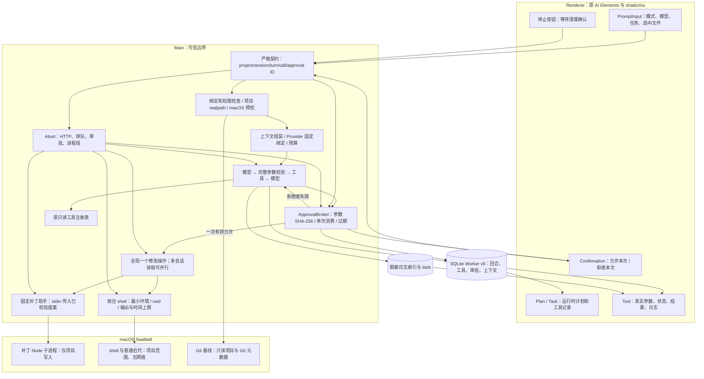

# 阶段 6：项目写入、命令与审批

本阶段在 macOS 提供“项目 Agent（逐次审批）”：读取项目、提交计划、提议文件修改或命令，由用户逐次允许或拒绝。普通聊天、只读 Agent 保留原边界。阶段验收状态见 [工作计划](./work-plan.md)，具体检查记录见 [工作日志](./work-log.md)。

## 使用方式

1. 选择本地项目，配置支持工具调用的 Provider 与模型。内部通用聊天不能运行文件工具。
2. 在“设置 → 权限与限额”选择应用或项目作用域，将项目权限设为“每次询问”并保存。
3. 返回聊天，选择“项目 Agent（逐次审批）”，输入任务；可指定项目相对路径作为上下文。
4. 模型提出 apply_patch 或 run_command 时，原 Confirmation 自动展开完整参数。检查项目、路径、预期版本、新内容或命令后，选择“允许本次”或“拒绝本次”。没有会话级永久授权。
5. 执行结果、退出码、错误和脱敏日志来自本机实际运行。停止先显示正在清理，完成收尾后才进入终态。已有修改保留；失败或中断不会自动重放写入。

“每次询问”是可申请的策略，不代表批准所有后续操作。目录外访问、无隔离降级、网络访问、后台常驻程序不在当前授权范围。未满足实际 OS 预检条件时，Main 拒绝进入可写模式。

## 执行架构



## G02：Git 基线

沿目录寻找 Git 标记，再在只读 Seatbelt 中查询 root、HEAD 和 porcelain 状态。禁用全局/系统 Git 配置、fsmonitor、可选锁和交互；每次查询最多 5 秒、1 MiB。这样 Git 配置中的过滤器即使被触发，也不能写项目或联网。查询失败、非 Git、暂不支持的平台均明确返回不可用，不阻断普通项目聊天。

开始前和结束/失败/取消后的基线保存在 agent_info，随历史恢复；界面明确列出前后状态数量。状态差异只用于观察，不能将用户原有修改或外部变更归因 Agent。状态指纹不代替文件内容版本。当前没有 Git 暂存、提交、重置或自动回滚。外置 Git worktree 元数据不在此阶段扩大读取范围，可能显示基线不可用。

## T04：有版本检查的文件替换

工具名称为 apply_patch，当前请求格式为 bounded JSON 文件替换集合，不是任意 shell 补丁。每个 changes 元素包含项目相对 path、expectedHash 和 UTF-8 content。expectedHash 为 read_file 返回的完整文件 SHA-256；null 表示文件必须不存在。

- 最多 20 个文件，每文件最多 256 KiB；整个 Agent 参数流另有 256 KiB 上限。
- 拒绝目录越界、符号链接、已有硬链接、二进制、非 UTF-8、秘密文件和已知敏感内容。
- 每文件独立检查与返回 applied/conflict/failed/cancelled，部分成功不声明为整批事务。
- 新文件用 no-replace 链接发布；已有文件在临时内容落盘和第二次版本检查后替换。
- 已有文件保留 `.devly-before-*` 原始 inode，并返回 recoveryPath。此类恢复文件不自动发送给模型、不自动删除；可在核对后手动清理。取消不回滚已发布的文件。
- 生产入口通过固定 Node 补丁助手运行，助手自身在 Seatbelt 内；即使并发替换父目录，OS 也不授予项目外写入。

一般文件系统没有对不合作写入者的通用原子内容 CAS。最终检查至 rename 仍有极小竞争窗口，保留原 inode 避免旧内容失去可达路径；这不等于编辑器协同锁或事务。正在并发编辑的项目应先核对恢复版本。完整 Diff/编辑保存、删除和重命名交互由阶段 7 承担。

## T05/T07：命令和实际主机边界

run_command 支持 command、项目内 cwd、100–120000 ms 的超时、256–262144 字节的输出上限；默认 30 秒、64 KiB。命令为非交互 `/bin/sh -c`，stdin 关闭，仅继承明确 PATH 和 locale，不继承供应商 Key 或 Renderer 自定义环境。当前 PATH 为系统命令目录；依赖个人 shell 配置、Volta/Homebrew 等工具链的命令可能不可用，不将预检文本成功视为任意构建命令均已支持。

命令与补丁都使用 deny-default Seatbelt，无无隔离回退。允许项目与必要系统运行资源，拒绝目录外内容读写、敏感路径、Git 元数据写入和网络。固定补丁助手另外获得自身代码与 Node/Electron 运行文件的只读权限；这些额外读路径不会交给模型 shell。Git 查询采用单独的只读配置。设计参考 [Codex 的隔离说明](https://openai.com/index/inside-the-codex-sandbox/)，本项目的实现与覆盖范围以实际测试为准。

stdout/stderr 使用 UTF-8 增量解码、跨块 Key 前缀保留和按行脱敏。完整行可以在结束前显示；没有换行的尾段可能等待结束才出现。达到输出限额明确标记截断并停止，不伪造成功。超时/取消先 TERM 后 KILL 受管进程组，等待退出与管道关闭；清理失败或超期不确认时显示 EXECUTION_STATE_UNKNOWN，终止当前循环，不自动重试。

**剩余边界：** cwd 和 worktree 本身不是沙箱；当前不是 VM，也不是对恶意本地进程的全面隔离。独立脱组/双重 fork 的后台进程树不在已验证的进程组清理保证内，界面明确说明未知范围，不授权常驻程序。macOS 预检/受控前台程序验证不代替 Windows T12、不代表任意用户构建工具都可执行。

## T06/T08/A06/A07：审批、调度与停止

- 每个请求绑定 projectId/sessionId/turnId/callId、不可变参数摘要、approval UUID 和到期时间，默认 60 秒。
- Renderer 只能响应 ID/digest/allowed，不能在响应中替换命令或文件参数；Main 复核当前运行、项目归属、取消状态、完整作用域与有效期。
- 拒绝、过期、错归属、重复、取消、关闭都不扩大权限；拒绝和参数错误作为工具结果回到模型。参数未完整解析和验证时不能执行。
- SQLite v8 的 approvals.payload 保存摘要/有效期/状态；原表外键继续绑定工具与会话。异常重启使 pending 审批失效、活动工具/回合标为中断；不恢复旧授权，也不自动续跑。
- 同时最多 4 个运行会话；一个回合内工具有序执行。修改操作全局并发为 1，连嵌套项目也不会绕过同一文件串行要求。只读工作可在不同会话进行。排队中的取消可以立即收尾，实际运行的操作必须等待清理。
- 每个结果和日志都保留原调用 ID；晚到事件只写原回合，不能污染新回合。已执行修改不因停止被撤销。

## U04/U05/U06：界面与真实度

Confirmation、Plan、Task、Shimmer 及配套 Alert/Card 来自与原有组件相同的固定 AI Elements 提交，只有仓库别名适配。来源、许可证和 SHA 校验见 components/ai-elements/SOURCE.md 与 resources/vendor/ai-elements.json。motion 12.42.0 与锁定的三个配套包为 MIT，React 18/19 peer 范围；已保留安装版本的许可文件。旧版本维护/依赖安全与签名发行阻断仍不因本次新增组件而解除。

计划由 update_plan 提交给运行时，完成项必须关联当前回合已成功的工具调用；没有计划时仅显示真实执行记录。不把模型文字或成功调用的关联直接等同于任务结论已被证明。审批提交后本地立即禁用对应按钮，Main 仍进行一次消费核对。

停止期间显示“等待网络、审批队列与进程清理确认”；状态未知时要求核对项目。可写回合不提供自动重发副作用的按钮；用户可在核对后发送新任务。跨重启续跑在 R02 前保持不可用。

用量优先显示供应商报告；Agent 上下文另按序列化消息与工具定义字符数 / 3 粗略估算，明确标注估算。配置 contextWindow 才显示占比；未知窗口不编造分母。估算不是 tokenizer 精确计数或账单。供应商未返回可信费用时显示未知，不引入虚构实时价格；maxCost 仅为预算偏好，当前不保证美元硬停止。既有本地 Token/供应商预算与可查询余额见 [用量与额度](./usage-and-budget.md)。

## 检查入口

```bash
pnpm check
# macOS 显式主机检查；外层沙箱禁止嵌套 sandbox_apply 时需在正常本机环境运行：
pnpm verify:execution-host
pnpm verify:execution
pnpm verify:execution-ui
```

默认测试跳过两项需要实际 Seatbelt 的检查，不把跳过视为平台通过。显式检查使用自动清理的临时项目、真实进程/SQLite/GUI 与本地协议替身；没有调用用户 API、读取真实明文 Key 或修改用户项目。阶段 7/A09 再验证真实第三方 API 的完整编辑器与 Diff 样例。
