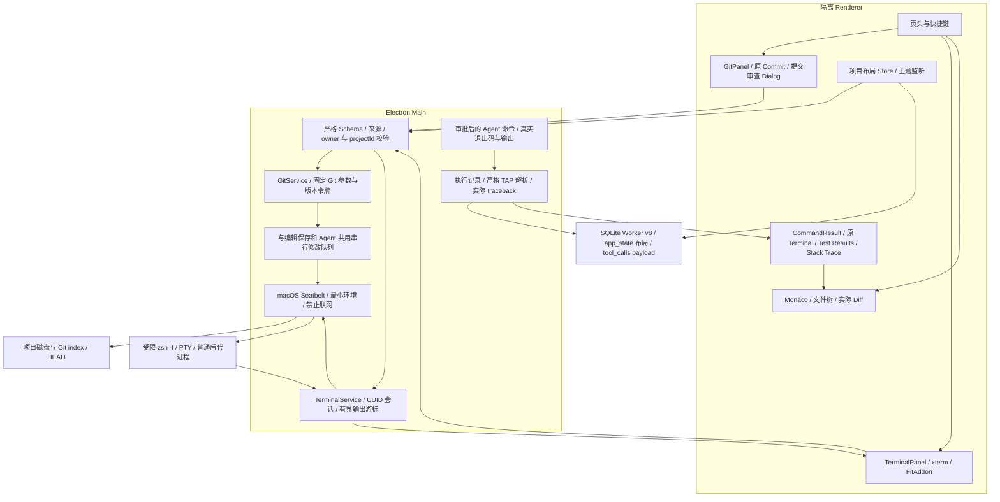

# Git、交互终端与桌面工作台

阶段 8（G06–G09、X01–X04、U07/U08）的实现说明。当前范围为 macOS ARM64；阶段状态、验证结果以 [工作计划](./work-plan.md) 和 [工作日志](./work-log.md) 为准。编辑、保存与实际 Diff 的基础见 [编辑器说明](./editor-and-diff.md)。

## 使用入口

打开本地项目后，页头的“Git 工作区”显示当前仓库与真实提交记录；“终端”展开项目交互 Shell。文件区、聊天区和底部终端都可以通过分隔条调整。设置 → 外观可保存浅色、深色或跟随系统主题，应用、Monaco 与 xterm 同步。

| 操作            | 当前行为                                                                         |
| --------------- | -------------------------------------------------------------------------------- |
| 查看历史        | 第一父提交链，每页 30 条；原 Commit 显示实际作者、时间、hash、说明和文件变化     |
| 查看提交文件    | 展示实际提交的文件状态与增删数量；“打开当前文件”打开当前工作区版本，不是历史版本 |
| 暂存 / 取消暂存 | 只操作所选路径；新仓库没有 HEAD 时也可取消暂存，不删除磁盘文件                   |
| 本地提交        | 填写说明、作者与邮箱，审查完整暂存路径后明确确认；不会推送远端                   |
| 分支            | 创建并切换、切换已有分支、非强制删除已合并分支；没有自动 stash/reset/强制删除    |
| 用户终端        | 真正的 PTY + xterm，键盘输入、Ctrl+C、尺寸变化、多终端和关闭                     |
| Agent 命令      | 原 Terminal 展示只读执行日志；原 Test Results/Stack Trace 展示实际执行记录       |

非 Git 项目仍可编辑和使用终端；Git 面板显示不可用。写操作要求选择完整仓库根目录，选到仓库子目录、外置 worktree 元数据或不支持的仓库布局时不会扩大写入范围。

## 进程与数据流



共享入口位于 `src/shared/workbench-contracts.ts`，Git、终端与布局由既有 data 网关承载。Renderer 没有任意 Git、进程或 SQL 入口，也不取得 Provider 密钥。

| 契约                                         | 关键约束                                                                  |
| -------------------------------------------- | ------------------------------------------------------------------------- |
| git.snapshot/history/details                 | 注册项目、真实仓库根目录、合法 hash、输出/时间/数量上限；历史游标明确     |
| git.stage/commit/branch                      | 项目 + 当前快照 token；路径/作者/分支参数校验；版本变化拒绝而非重试副作用 |
| terminal.list/create/read/write/resize/close | owner + projectId + terminal UUID；输入块和尺寸受限；读取使用绝对游标     |
| layout.get/save                              | v1 严格结构、应用或项目范围；未知字段/非法尺寸拒绝，不覆盖原值            |

## Git 写入保护

快照 token 覆盖 HEAD、原始 status 和 index 内容指纹。用户审查后再执行时，变化会触发 stale 结果；与应用内编辑保存、Agent 写入共用串行队列。Git 子进程使用固定参数数组、literal pathspec、NUL 路径输入、受限环境，禁用 hooks、签名、fsmonitor、自动维护和已配置的外部过滤器。

未提交修改阻止创建/切换分支，未合并 index 阻止提交；保护路径已暂存也会拒绝提交。失败会保留现场并刷新，不隐式清理工作区。忽略和敏感内容不会作为普通文件详情返回。记录上限或 Git 输出上限触发时不能把不完整状态当成可完整审查的提交。

这不是对所有外部 Git 进程的原子事务。其他程序可能在最后检查后修改 index；失败后必须重新查看状态。没有跨进程仓库锁、历史文件编辑、远端 fetch/pull/push、复杂 worktree/submodule 管理；后续另行实现和验收。

## 交互终端生命周期

Main 使用 `node-pty` 启动 `/usr/bin/sandbox-exec` 内的 `/bin/zsh -f`，cwd 是注册项目的规范路径，HOME/ZDOTDIR 指向项目，不加载个人 Shell 配置，不继承模型凭据。仅系统 PATH；终端明确标记为受限 Shell。网络、目录外写入、敏感文件和直接 `.git` 写入不开放；Git 操作通过面板的固定接口完成。个人工具链、安装依赖、网络服务不在当前交互终端保证内。

每项目最多 4 个、每窗口 owner 最多 8 个、全局最多 32 个终端。每个终端输出保留最近 262144 个 JavaScript 字符；读取返回 start/end 游标与截断标记，Renderer 不把丢失的旧输出伪装成完整日志。xterm 本地 scrollback 为 2000 行。输入串行发送，失败不自动重放，尺寸由 FitAddon/ResizeObserver 同步。

隐藏终端或切换项目保留 Main 进程；切换后输入输出仍属于原项目/终端 ID。关闭、窗口释放与应用退出会收集普通后代 PID/进程组，TERM/KILL 后检查实际状态；不能确认时显示 unknown。已退出会话不使用旧 PID 再发信号。普通前后台子进程的清理有本机证据；双重 fork、脱组或父进程提前退出的后台任务不承诺完整追踪。cwd 和 worktree 本身不是沙箱，当前实际约束来自 macOS 系统机制；Windows 留 T12/X05。

终端进程、输入和滚屏不跨应用重启恢复；重启只恢复面板布局，不重放命令。Agent 的命令执行与用户终端分属独立生命周期，用户终端不会生成假的 Agent 工具成功记录。

## 测试结果与堆栈

执行器从真实命令的退出码、信号、耗时、stdout/stderr 生成 execution 元数据，保存到既有 `tool_calls.payload`。预览有界，完整脱敏输出沿用日志引用；旧工具记录缺少 execution 时保持空，不编造测试结果。

当前只解析完整一致的 TAP v13：计划数、顺序、结果与退出码均核对。原 Test Results 显示实际成功/失败/跳过；普通 exit 0 显示“未验证测试结果”，中断/截断显示不完整，报告与退出码矛盾显示冲突。未适配 Jest/JUnit 等其他报告格式，保留原始输出和真实进程结果。项目程序生成报告不等于测试设计正确，也不能证明所有功能经过覆盖。

实际 JS 堆栈及 Python traceback 可投影到原 Stack Trace；Python 帧只转换展示格式，原始 stderr 仍保留。点击项目内文件跳转 Monaco 对应行，目录外、越界或不存在文件会提示。原 Terminal 为只读，不接受 Shell 输入。

## 主题、布局与快捷键

布局 v1 保存在 SQLite Worker 的 `app_state`，key 为 `layout:v1:<project UUID>` 或全局作用域；复用数据库 v8，无新增迁移。保存侧栏宽度、编辑区/目录区/终端比例、面板展开状态，严格限制尺寸；去抖串行保存、拖动结束刷盘，错误显示未保存并可重试。迟到读盘结果不会覆盖更早的用户修改。正常写入完成后重启恢复；异常退出前尚未提交的布局变化不保证保留。

| 快捷键                          | 功能                           |
| ------------------------------- | ------------------------------ |
| Cmd/Ctrl + J                    | 显示/隐藏终端并调整焦点        |
| Cmd/Ctrl + L                    | 聚焦任务输入                   |
| Cmd/Ctrl + Shift + E            | 打开文件区                     |
| Cmd/Ctrl + Shift + G            | 打开 Git 工作区                |
| Cmd/Ctrl + S                    | 保留 Monaco 保存操作           |
| Ctrl + C                        | 终端获得焦点时中断真实前台进程 |
| 侧栏分隔条 Left/Right、Home/End | 调整侧栏宽度；双击重置         |

分隔条统一为 1px 中性边界，垂直/水平方向均有 9px 透明命中区域；悬停、键盘聚焦或拖动时显示 28px 短圆角手柄与柔和高亮，尊重系统减少动态效果设置。

最小窗口按 960×680 实测，侧栏和终端高度自适应，主要输入与保存入口在视口内；长日志/历史/编辑器使用功能内局部滚动。AppShell 仍是页面滚动边界，品牌 v5 图标没有变更。

## 验证与来源

```bash
pnpm check
pnpm verify:workbench-host
pnpm verify:git-workspace
pnpm verify:terminal
pnpm verify:workbench-ui
pnpm verify:results-ui
DEVLY_EXECUTABLE=release/mac-arm64/Devly.app/Contents/MacOS/Devly pnpm verify:workbench-ui
DEVLY_EXECUTABLE=release/mac-arm64/Devly.app/Contents/MacOS/Devly pnpm verify:results-ui
```

主机/GUI 检查需要允许 macOS 原生执行与窗口。临时 Git 仓库、实际 PTY 和实际 Python unittest 验证本地行为；模型调度采用本地协议替身，不把它记为新的供应商实测，也不读取个人 Key。开发/包内结果及发现的问题逐条记录在 LOG-054 起的日志。Windows、远端 CI、安装升级与签名验收独立保留。

Terminal/Test Results/Stack Trace 与既有 Commit 同属固定原 AI Elements 提交，仅别名适配；当前 14 个 AI + 20 个 UI + 许可证共 35 份离线哈希校验。来源见 [SOURCE](../src/renderer/src/components/ai-elements/SOURCE.md)。新增 ansi-to-react 6.2.6 的包声明 BSD-3-Clause，但上游缺完整版权通知，已记录声明与标准文本，权利人通知补全仍是正式发行门槛；不能把标准模板当成已获得完整许可通知。详见 [依赖评估](./dependency-review.md)。
