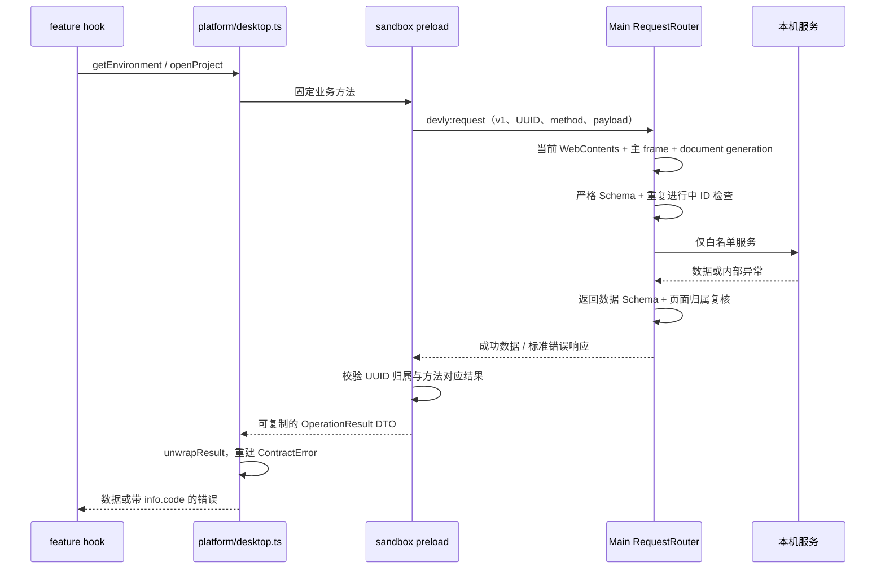

# B02：桌面通信契约与订阅清理

实施日期：2026-11-21。基础范围为环境检测、目录选择和 `environment.checked` 事件；后续通过版本化 data.execute 扩展本地数据及 Provider 诊断。阶段 3 的 start/read/cancel/release 使用同一归属与严格校验入口，具体见 [Provider API](./provider-api.md)。Agent/命令执行取消属于后续阶段。

## 调用边界



Renderer 不接触 ipcRenderer、任意 channel、原始 Electron event 或 Node API。Preload 只暴露固定业务方法；Zod 被打包到 preload，保持 sandbox 开启，避免沙箱内 require 外部模块失败。

## 请求与响应

请求为严格对象；未知字段、未知方法、非 UUID、错误版本或非法 payload 都被拒绝。请求 ID 由 preload 的 `crypto.randomUUID()` 生成，不由业务组件传入。

```ts
{ version: 1, requestId: 'UUID', method: 'app.environment', payload: {} }
{ version: 1, requestId: 'UUID', ok: true, data: /* 按方法校验 */ }
{ version: 1, requestId: 'UUID 或 null', ok: false,
  error: { code: 'INVALID_REQUEST', message: '请求参数无效', retryable: false } }
```

只有原始请求没有合法 requestId 时返回 null。合法 ID 对应的非法参数仍保留关联 ID。进行中的重复 ID 被拒绝；并发请求乱序完成时，各自按 ID 校验结果。此 ID 不是登录凭据，也不承担业务幂等或历史去重。

| 方法 | payload | 成功 data |
| --- | --- | --- |
| `data.execute` | `{operation,args}`，按白名单操作二次严格校验 | `{operation,data}`，客户端再次校验 operation 与结果 Schema |
| `app.environment` | `{}` | EnvironmentInfo，Git 缺失为 null；codex 为保留的 v1 可选诊断字段，正常启动不探测并返回 null |
| `project.open` | `{}` | 真实存在的目录 `{path,name}` 或取消后的 null |
| `events.subscribe` | `{type:'environment.checked'}` | `{subscriptionId:UUID}` |
| `events.unsubscribe` | `{subscriptionId:UUID}` | `{removed:boolean}`，重复清理返回 false |

错误码：`INVALID_REQUEST`（参数/限额）、`FORBIDDEN`（来源或归属）、`INTERNAL_ERROR`（服务异常/结果非法）、`INVALID_RESPONSE`（响应/事件形状或关联不符）、`TRANSPORT_ERROR`（IPC 连接失败）。仅内部错误和连接失败标记可重试，不自动重试目录对话框。

Main 不把底层异常、堆栈、文件系统错误文本或凭据复制给 Renderer。跨 contextBridge 使用 `{ok,data/error}` DTO，避免 Electron 复制 Error 时丢失自定义字段；gateway 在 Renderer 重建 ContractError。错误对象的 `info.code/message/retryable` 可供 UI 后续使用。

## 事件与生命周期

事件固定为 `{version:1,subscriptionId,sequence,type:'environment.checked',requestId,data}`。只有同一页面的环境检查会通知该页面订阅；sequence 按订阅递增，表示发布顺序，不表示请求开始顺序。

- Main 以 WebContents ID + 页面 generation 记录 owner，验证发送者为当前窗口主 frame；其他窗口/子 frame 不获授权。
- 异步操作完成后再次检查 owner，旧页面结果不返回成功，也不发布事件。
- 订阅 ID 由 Main 生成；其他 owner 不能取消它。每页最多 32 个订阅。
- Preload 先注册受控 listener，再请求订阅；确认前最多暂存 32 条事件，确认后按 subscriptionId/sequence 过滤。
- 返回的清理函数同步停止回调、移除本地 listener、清空队列，并异步取消 Main 订阅；重复调用无副作用。
- 如果清理发生在订阅确认之前，确认后立即补发取消请求，不重新注册 listener。
- 页面完整导航/刷新、Renderer 崩溃或 WebContents 销毁时，Main 清空该 owner 的所有订阅。普通组件卸载由调用方调用清理函数。
- 清理后取消请求即使失败也不再调用已卸载的错误回调；Main 页面生命周期清理作为最终兜底。

业务层使用示例：

```tsx
useEffect(() => {
  return desktop.onEnvironmentChecked(
    (event) => console.log(event.sequence),
    (error) => setError(error.message),
  )
}, [])
```

现有环境面板仍使用请求响应更新状态，保留 B01 的过期请求保护；本次没有改变为依赖事件的状态模型。订阅接口通过真实桌面 smoke 验证，供后续 feature 使用。事件是瞬时通知，没有持久化、重放或断线自动恢复；订阅取消不等于取消已开始的本机操作。

## 验证入口与文件

- `src/shared/contracts.ts`：Schema、DTO、错误码和响应解码。
- `src/main/request-router.ts`：分发、归属、限额、发布和清理；`src/main/index.ts` 接 Electron 生命周期。
- `src/preload/desktop-client.ts`：关联校验和订阅竞态处理；`src/preload/index.ts` 只桥接受限 API。
- `src/renderer/src/platform/desktop.ts`：业务入口、浏览器降级与 DTO 解包。
- `pnpm test`：非法参数、来源、结果校验、异常脱敏、并发归属、旧文档结果、跨 owner 取消、幂等清理、资源限额、提前清理和订阅失败。
- `pnpm verify:desktop`：真实 Electron bridge、错误 DTO、事件投递/停止回调及既有界面回归。目录选择的对话框返回由测试替换，其后的文件系统与 IPC 使用真实实现。

阶段 2 补充：固定 data.execute 只接受 shared/data-contracts.ts 的操作白名单，Renderer 不能发送 SQL、原始 Key 或任意文件路径。项目/会话 ID 必须配对，分页和分段读取有上限；结果仍通过 v1 requestId 和 operation 两层归属校验。新增错误码 NOT_FOUND、PROJECT_UNAVAILABLE、STORAGE_UNAVAILABLE、CREDENTIAL_UNAVAILABLE、LIMIT_EXCEEDED，均只带固定消息。原生对话框返回后再次检查页面归属，未开始的旧页面操作拒绝执行；已提交的持久化写入不承诺因页面切换自动撤销。详见 [本地数据说明](./local-data.md)。

阶段 4 增加严格的 sessions.bind、chat.start/read/cancel；发送只接受项目/会话/回合 UUID 和有界文本，不接受 Renderer 提供的 Key、端点或供应商替换。会话绑定另行明确操作，有历史时需要 allowHistory。取消核对项目/会话/回合，错误返回固定 DTO；已接受回合的主进程生命周期独立于窗口订阅，页面卸载只清理可见快照轮询。详情见 [聊天契约与恢复](./chat.md)。
