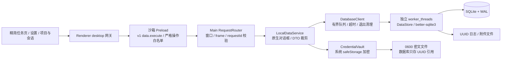

# 阶段 2：本地数据、项目与设置

实施：2026-11-21；任务 L01–L07。此阶段保存本地元数据、设置、凭据引用与日志索引，此处描述阶段 2 基础；阶段 4 普通聊天扩展见 [聊天说明](./chat.md)，阶段 5 的只读工具扩展见 [只读 Agent](./read-only-agent.md)。验收结果以工作日志和工作总表为准。

## 存储与进程

正常根目录为 `app.getPath('userData')/storage`，macOS 通常为 `~/Library/Application Support/Devly/storage`。数据库是 `devly.sqlite`，同级有 backups、blobs、credentials；DB/凭据文件限制权限，目录限制为当前用户。Windows 的实际 ACL/原生后端仍需平台实测，不能用 POSIX mode 数字声称已验证 Windows 权限。

测试仅通过受信任启动环境 DEVLY_USER_DATA_DIR 指向临时目录；这个路径不能由 Renderer 设置。GUI 检查结束后删除测试目录，不污染用户数据。正常应用采用 Electron 单实例锁，避免两个 Main 同时对同一目录执行 orphan 清理。

Database Worker 的 SQLite 和文件操作在独立线程中运行，线程 API 依据 [Node Worker 官方文档](https://nodejs.org/api/worker_threads.html)，具体能力同时以当前 Electron 的实际测试为准。请求队列最多 128 个待处理项，单次数据库请求超时 15 秒；异常退出或超时会统一拒绝待处理请求并终止 Worker，不自动重放可能已写入的操作。启动失败仍可看到应用与存储错误/重试提示，不静默删除旧库。正常退出先排空此前已发送的请求、checkpoint 并关闭数据库；SQLite WAL 支持异常中断后的恢复，未承诺所有电源故障情形。

## 版本迁移与恢复

- v1：projects、app_state、settings、providers。项目用 canonical realpath 去重，软移除；设置分 global / 项目 UUID 作用域；Provider 只存元数据和 credential_ref。
- v2：sessions、turns、messages、message_parts、tool_calls、approvals、events、blobs，以及复合归属约束和分页索引。
- v3：Provider compatibility、revision、report。
- v4：会话模型绑定、回合身份/状态/时间/用量、消息关联与每会话单活动回合索引；升级恢复旧运行记录，保留旧会话与消息。
- 每个版本在 SQLite transaction 内更新表与 user_version。已有库升级前使用 SQLite backup 创建独立备份，不把复制仍在写的 WAL 文件当作一致备份。
- 失败回滚当前版本 DDL 和版本号，保留旧数据与备份；不自动“删库重建”。高于当前代码支持的版本拒绝打开，避免降级写入。
- 自动启动清理只针对应用自身 UUID 命名的 orphan 临时/密文/blob 文件，保留有索引引用的文件；迁移备份保留最近 3 份。手动恢复须先退出应用，保留故障库和备份，再复制选定备份，不能在应用运行时覆盖数据库。

## 项目和会话

项目打开先经原生目录对话框、realpath 和目录检查，再写入 Repository。最近项目可切换/移除；移除只隐藏记录、清除活动项目引用，不删除项目目录或关联会话，重新打开同一目录恢复原 ID/历史。失效路径在侧栏标记，切换时返回明确错误。

会话有自有 UUID 与项目归属；可新建、重命名、归档、恢复及分页读取。活动项目与每项目的活动会话记在 app_state，重启恢复元数据。归档活动会话时清除其活动引用。页面切换不会把 A 项目的会话当成 B 项目的内容。

会话、消息和日志列表采用 `(time,id)` 降序 keyset 分页，默认 30、最多 100；侧栏按 20 条读取并按需加载。消息分段与日志只读取请求的一页/区间。项目、会话 ID 需要配对校验；SQL 复合外键覆盖回合、消息、工具调用、审批、事件和 blob 的会话归属。

阶段 4 已使用 turn/message 表保存实际普通聊天回合、消息分段与中断状态；tool/approval/event 的 Agent 执行仍未接入。Renderer 只有受校验的发送/读取/取消接口，没有任意 SQL 或任意消息插入。正常退出先终结后台聊天，再关闭 Worker；异常启动只标记中断，不自动续发。

## Provider 与凭据

Provider Repository 支持名称、协议、Base URL、模型与凭据引用；Base URL 拒绝非 HTTP(S)、URL 内用户名/密码、query 和 fragment，元数据严格拒绝 apiKey 等额外字段。阶段 3 已增加供应商编辑和诊断，见 [Provider API](./provider-api.md)。v3 迁移新增 compatibility、revision、report；配置或凭据修改递增版本并清空证据，报告条件写回防止旧响应覆盖新配置。旧 v1/v2 迁移保持不变。

为了遵守 API Key 不进入 Renderer 的仓库约定，credentials.set 只接受 providerId。Main 弹原生隐藏输入框（macOS osascript / Windows 原生控件），主进程接收输入，调用系统 safeStorage 加密后保存到 UUID 文件；不将明文放入命令行参数、数据库、日志或 Renderer DTO。取消不覆盖已有密钥，保存后的列表只有 hasCredential。替换先写新密文再切换数据库引用，旧密文随后删除；未引用密文在下次启动清理。原生凭据输入串行处理。

safeStorage 不可用时拒绝保存，不退回明文；Linux basic_text/unknown 后端拒绝使用。Electron 39 本地 API 只有同步 safeStorage；当前使用的是该已安装 API，不假装已升级为新版异步接口。此处的系统调用可能因系统授权而短暂等待。平台保护差异与 unsigned 授权限制参见 [Electron safeStorage 官方文档](https://www.electronjs.org/docs/latest/api/safe-storage)。macOS unsigned 开发包不能保证跨版本钥匙串识别与授权体验稳定，正式分发仍需后续签名与平台验收。

凭据生命周期单元/数据集成使用注入的加密引擎验证替换和失败行为，真实桌面检查另用 OS safeStorage 做加密写盘/解密往返。两类证据分别记录；原生输入框没有自动输入用户真实 Key，也没有请求真实模型。

## 设置

Settings v1 包括主题、默认供应商/模型、只读或每次询问的项目权限、Token 与 USD 限额。可保存应用默认值或当前项目覆盖值；没有项目覆盖时继承应用值。严格校验版本、枚举、数值和供应商引用；非法写入不替换已有设置。

深色、浅色和跟随系统由保存值驱动，系统主题监听可清理。设置导出通过 Main 原生保存对话框，重新从数据库读取已保存的严格 Settings，原子写 JSON，不导出凭据引用、密文或明文。尚未接入执行器与费用统计，权限/预算目前只是持久化策略配置，不声称已约束尚不存在的 Agent。

## 大日志与附件

Renderer 不能传任意磁盘路径，blobs.import 通过 Main 原生文件对话框授权，再由 Worker 流式复制到 UUID.bin。数据库只保留项目/会话归属、名称、MIME、字节数和时间等索引，文件名不能作为读文件路径。

- 每文件最多 64 MiB，应用 blob 索引总量最多 256 MiB；流中再次计数，防源文件复制时增长。
- 分段读取最多 64 KiB，返回 base64、offset、total、truncated，不把大文件整体发给 Renderer。
- 删除索引不会删除原始导入文件；有消息/事件引用的 blob 由外键保护。
- prune 只清理指定会话、早于指定时间且未被消息/事件引用的日志；附件不自动过期，超过总量上限拒绝导入。
- 导入中断临时文件和未入库文件会清理；故障遗留的 orphan 在下次启动回收。缺失的已索引文件读取报错，不返回虚构内容。

## 检查入口

| 命令 | 证据范围 |
| --- | --- |
| pnpm test | IPC/设置/Provider 参数边界、禁止明文字段、分页上限等 |
| pnpm verify:data | Electron ABI 的 SQLite Worker、重启、迁移失败/回滚/备份、跨项目外键、分页、日志与凭据引用生命周期 |
| pnpm verify:persistence | 真实桌面双项目重启、会话操作、设置/主题、系统 safeStorage、导出与日志导入；临时 userData |
| pnpm verify:desktop / verify:no-codex | 精简界面、原 IPC、开发者选项和无 Codex 启动回归 |

构建后可用 DEVLY_EXECUTABLE 指向包内程序做同样的桌面持久化检查。Windows、远端 CI、签名、迁移后的正式升级包、模型调用等未执行内容必须保持单独的未验证标记；当前依赖维护风险仍见 V01 评估。

主要实现：src/main/data/、src/shared/data-contracts.ts、共享 IPC、Renderer store/设置/侧栏；实际完成记录见 LOG-014–LOG-021。

## 阶段 5 数据扩展

SQLite 当前 v7：v7 新增 provider_usage_budgets 和供应商回合用量聚合索引，保存每供应商预算/计数起点，已有 turns.usage 保持真实上报与缺失值，详见 [用量与额度](./usage-and-budget.md)；v5 新增回合 agent_info、tool_calls 的结构化 payload/顺序和近期会话索引；v6 新增 projects.managed，保存内部通用聊天归属，原项目/会话 ID 不变。工具日志使用既有 UUID blob 配额/索引/读取/保留策略，只存脱敏输出。sessions.recent 跨未移除项目分页，select/rename/archive 仍按会话项目配对验证。sessions.general 建立不显示为项目的私有聊天归属；Main 禁止其文件工具。projects.create 只接受原生对话框选定的新目录，拒绝覆盖。详见 LOG-042/LOG-043。
