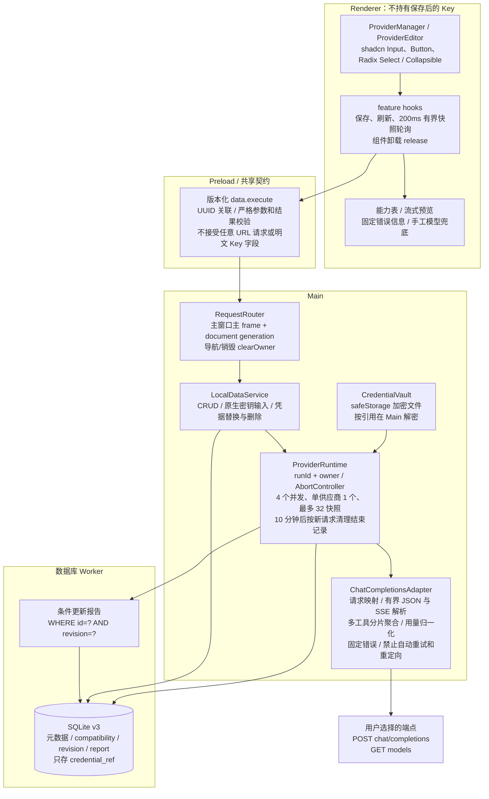

# 第一个第三方 API：实现与验收（P01–P06）

更新：2026-11-21。代码及本地 HTTP/桌面验证已落地；**真实供应商验收待完成，阶段 3 保持待验证**。用户已表示会在 Devly 中配置有效端点和模型；本文和工作日志不保存密钥。

## 使用方式

1. 打开设置 → 添加供应商，填写名称、Base URL、模型 ID。协议选择 OpenAI-compatible Chat Completions；另外两个协议尚未接入。
2. Base URL 是 API 根路径，例如 `https://api.example.com/v1`；实际请求追加 `/chat/completions` 或 `/models`，不自动猜测 `/v1`，不自动改用其他协议。
3. 添加表单内直接显示 API Key 和设置密钥按钮。填写名称和地址后点击设置密钥，会先保存元数据，再由 Main 打开系统原生输入框；界面只显示“未设置 / 已设置 · 受系统保护”，支持替换和清除。取消输入不会删除原有密钥；无认证的本地端点可以不设 Key。保存的 Key 无法读取时直接失败，不降级成无认证。
4. 点击读取模型列表。若接口不存在、拒绝访问或格式不符，保留手工模型 ID，不因此阻止文本请求；从列表选择后需要保存模型更改。
5. 保存按钮旁的“测试连接”在首次添加时也可用：自动保存当前配置并发送真实非流式文本请求，就地显示测试中、连接成功、失败原因或取消。成功只代表该模型文本请求通过；修改配置后旧结果显示失效，未修改配置不会反复新建记录或清空其他能力证据。下方“检查连接”仍依次检查文本、流式和工具调用/结果回传，也可单项检查。两类操作只发送固定诊断内容，可能产生少量费用，不读取项目文件。
6. 兼容参数可选择 `max_tokens` / `max_completion_tokens` / 不发送、Temperature、流式用量、工具开关、视觉/结构化输出声明和手工上下文窗口。改动后保存并重新检查。总超时默认 30 秒，可设置 1–120 秒；支持取消。

不把诊断界面当成任务聊天：工作台发送仍禁用，真实会话聊天属于阶段 4，工具执行循环属于阶段 5。

## 已实现的模块与数据流

文件职责：`src/shared/provider-contracts.ts` 定义 ProviderAdapter、消息/图片/工具结果、工具定义、Completion、Usage、流事件及检查 DTO；`src/main/providers` 实现适配、生命周期和安全错误；`src/main/data` 保存配置与凭据引用；`features/provider-settings` 承载界面和轮询清理。

Main 内部的 `ProviderStreamEvent` 包含 text/tool/usage/finish。阶段 3 的 Renderer 使用受归属保护的快照读取累计预览，最大 4096 字符；不向 Renderer 暴露供应商原始响应结构。后续任务消息流另按阶段 4 接入，不修改现有环境事件语义。

## 请求与响应规则

- 输入消息使用统一 role/content、toolCalls、toolCallId；适配器映射为该协议要求的 `tool_calls`、`tool_call_id`、图片块和 `response_format`。
- 多个工具调用按流的 index 聚合独立 ID、名称和 arguments，完整结束后校验 JSON 对象、ID 唯一及顺序；半段参数不会作为完整工具结果交付。
- SSE 支持 UTF-8 字节边界、CRLF、多行 data 和注释；要求合法 finish_reason 和完整 `[DONE]`。兼容服务若省略结束标记会明确报告 DISCONNECTED，不把半截响应标成成功。
- 响应总字节上限 2 MiB，SSE 帧/工具参数上限 256 KiB，工具调用最多 64；模型列表返回最多 1000 个 ID。未知 Token 用量保持 null，没有费用推算。
- Base URL 仅允许 HTTP(S)，禁止 username/password/query/fragment；HTTP 的明文传输影响在输入处提示。网络请求仅在用户点击诊断后进行。
- Main 解密 Key 后设置 Authorization；不记录请求头、原始响应错误、异常堆栈或 Key。诊断预览和模型列表会过滤已知 Key 的完整回显与流尾部的未完整回显；不承诺识别服务端任意编码过的恶意回显。
- 不跟随 HTTP 重定向，不自动重试，不自动切供应商，不在失败后重复发送上下文。协议仅实现 Chat Completions；Responses/Anthropic 元数据可保留，但诊断会拒绝执行。

## 能力与证据

| 项目 | 证据来源 | 成功标准 | 未知或禁用处理 |
| --- | --- | --- | --- |
| 非流式文本 | 单项或连接检查 | 返回非空文本并正常 stop | 显示未知或具体错误 |
| 流式文本 | 独立 SSE 检查 | 收到文本分片及完整结束 | 普通文本成功不改变流式状态 |
| 工具调用 | 独立工具检查 | required 调用 devly_probe，参数 nonce 正确，回传所有调用结果后再次获得文本 | 禁用时直接拒绝，不静默删 tools / tool_choice |
| 结构化输出 | 单独检查 | 发送 JSON Schema，返回 ok=true 的 JSON | 未知可显式检查；手工“不支持”时禁用 |
| 视觉 | 手工声明 | 本阶段未做视觉实测 | 默认未知；未声明支持时适配器拒绝图片 |
| 上下文窗口 | 手工数值 | 不通过短测试推断容量 | 未填为未知，不捏造模型规格 |

工具检查只回传固定诊断结果，没有注册文件、终端或命令执行入口。它证明模型工具协议往返，不证明 Agent 已经可操作项目。手工声明与检查结果分别展示；失败不笼统推断为模型永久不支持。

数据库 v3 给 providers 增加 compatibility、revision、report。配置保存、更换/清除凭据会递增 revision 并清空报告；运行期间更改配置会取消旧检查，写回还需匹配 revision，旧响应不能覆盖新配置。报告只存检查类型、时间、成功与否、固定错误和真实用量，不保存响应正文或 Key。删除供应商连同报告和受保护凭据清除。

## 网络生命周期与 IPC

| 场景 | 检查错误码 | 行为 |
| --- | --- | --- |
| HTTP 401 / 403 | AUTHENTICATION / ACCESS_DENIED | 分别提示密钥和权限问题 |
| HTTP 429 | RATE_LIMITED | 解析 Retry-After 秒数/日期，最多显示 86400 秒，不自动重发 |
| HTTP 5xx | SERVER_ERROR | 固定服务错误，不透传服务正文 |
| 其他非 2xx | BAD_REQUEST | 提示模型 ID / 兼容参数，模型列表仍可手工兜底 |
| DNS、TLS、连接失败 | NETWORK | 保留配置，用户手动重试 |
| 总时限到期 | TIMEOUT | Abort 中止底层 fetch/body |
| 流中断或缺失结束 | DISCONNECTED | 已显示部分文本，整体仍失败 |
| JSON/字段/工具参数不合法 | INVALID_RESPONSE | 不交付不完整工具调用 |
| 点击取消、关闭编辑器、页面销毁 | CANCELLED | 中止请求，停止轮询；不写取消结果覆盖旧证据 |
| 更换配置 / Key | CONFIG_CHANGED | 旧 run 失效，不覆盖新配置报告 |

`providers.probe.start` 接受已保存 providerId、runId、kind、timeoutMs，立即返回 runId；read 读取有界快照，cancel 中止，release 中止并释放。参数中没有用户消息、任意 header 或 Key。每项仍经过版本/请求 ID/结果校验；跨 owner 的 read/cancel/release 被拒绝。订阅环境事件的接口保持原状。

## 验证记录与剩余验收

| 检查 | 当前证据 | 边界 |
| --- | --- | --- |
| pnpm test | 56 项通过，其中新增 26 项适配/能力/归属测试 | 注入 fetch fixture，不是供应商实测 |
| pnpm verify:data | SQLite Worker、凭据生命周期、报告版本失效、v2→v3 迁移/回滚/备份通过 | 加密生命周期用注入 AES；真实 OS 保护另有桌面验证 |
| pnpm verify:provider | 真实 Electron + loopback HTTP，UI CRUD、SSE 增量、工具往返、模型 404 兜底、结构化输出、重启报告、错误/超时/取消通过；实际 OS 加密 Key 替换、重启后 Main 解密并认证、UI 清除与临时 profile 明文扫描通过 | 使用 Main 内注入的测试密钥和原生 prompt 替身，不自动填写真实密钥或声称供应商通过 |
| 真实供应商 | 待用户在应用内保存有效配置 | 尚无真实协议/模型/时间的通过记录 |

真实验收后在工作日志记录日期、协议、模型、文本/流式/工具结果。不要记录 Key、Authorization 或包含凭据的 URL。当前不能勾选真实端点验收，也不能进入阶段 4。

协议参照：[Chat API 官方定义](https://developers.openai.com/api/reference/resources/chat)、[Models list 官方定义](https://developers.openai.com/api/reference/resources/models/methods/list)。这些资料只定义协议，本项目对第三方端点的支持仍以实际检查为准。
