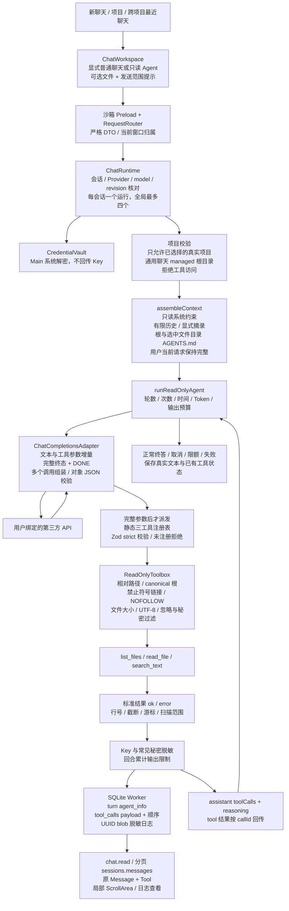

# 阶段 5：只读 Agent 与上下文控制

更新：2026-11-22。任务 T01/T02/T03/T09/A02/A03/A04/A05/U03；验收和状态以 work-plan.md、work-log.md 为准。原 AI Elements Tool 组件保持上游原文件，业务适配在 AgentTrace 中实现。

## 使用

1. 侧栏“新聊天”可创建独立通用聊天，无需先打开文件夹。项目与“最近”独立显示；最近列表跨项目分页，点击聊天恢复所属项目、会话和历史。项目标题右侧分别提供“新建项目”（原生位置/名称对话框，创建空文件夹）与“打开已有项目”。移除项目仍只移除记录。
2. 普通聊天只发送输入与已完成的聊天历史。选择一个真实本地项目，在输入框上方切换为“只读 Agent”，才授权该回合按需读取项目。没有项目的通用聊天无法启动文件工具；Main 再次校验此限制。
3. 可选填写项目相对文件路径，以逗号分隔，最多 12 个。系统发送只读策略、有限历史、项目 AGENTS.md、这些选中文件及其目录约定；后续工具结果也会发给当前绑定的模型。界面显示来源，工具卡片显示实际参数、调用 ID、状态和结果。
4. 工具结果可展开；“查看脱敏原始日志”读取对应的本地日志索引，单次最多 64 KiB。结果截断、跳过文件、扫描上限和失败均显示真实状态。点击停止会中止模型请求，检查中的工具在后续边界停止，不执行未完成参数；不重发请求或继续下一轮。
5. 当前进程中已明确选择的会话模式保留到该会话的后续消息；新会话默认普通聊天，重启后模式也回到普通聊天，需要重新选择只读 Agent。历史工具记录仍可查看，重启不会重放工具或继续旧运行。

## 架构与执行顺序



没有将文件写入、终端、网络请求、任意函数或模块导入注册为模型工具。项目创建是用户点击后的原生对话框操作，与模型工具注册表分开。

## 三个工具

| 工具 | 参数 | 结果与边界 |
| --- | --- | --- |
| list_files | path 默认 .；offset 0–10000；limit 1–100 | 单层、有序目录项；nextOffset/truncated。目录最多 10000 项，不跟随符号链接 |
| read_file | path；startLine 从 1 开始；limit 1–300 | 行号、总行数、nextLine、truncated；单文件最多 256 KiB、UTF-8、非二进制；正文最多 12000 字符。超长单行会截断且不提供假的续读行号 |
| search_text | query 为 1–200 字符的区分大小写字面量；path 默认 .；offset 0–1000；limit 1–100 | 路径/行号/最多 500 字符的命中行；每次最多扫描 500 文件/2000 项/16 层。再次分页重新扫描；达到扫描限制时标明 scanLimit/truncated，要求缩小范围 |

所有参数必须为完整对象 JSON；额外字段、错类型、未知工具均拒绝。增量参数只作为 proposed 显示，收到明确 tools 终态与 [DONE] 且所有调用参数完整后才执行。工具调用 ID 在同回合不得重复，结果用对应 toolCallId 回传；半包、断流和无效 JSON 不产生文件工具执行。

## 文件与上下文边界

- 项目根采用已登记 canonical 路径。拒绝绝对路径、父目录跳转、Windows 盘符/反斜杠与超过 16 层路径；根目录被替换为符号链接时拒绝。各层 lstat、realpath 范围、最终 NOFOLLOW 打开、文件 inode/大小/修改时间及读后检查共同防止常见路径替换；失败时不返回读取内容。这是应用层检查，不代替阶段 6/12 的操作系统隔离验收。
- 使用固定 ignore 7.0.16 处理根及祖先目录 .gitignore，包含 Git 风格否定规则；父目录已被忽略时不会绕过。忽略规则不可读时关闭该路径访问。固定排除 .git、node_modules、构建产物、缓存、.ssh/.aws/.codex/.agents 等目录和 .env、credentials、密钥/数据库等文件。
- 含当前 Provider Key、常见秘密赋值或私钥特征的文本文件拒绝发送；工具记录再次脱敏。扫描器是保守过滤，可能拒绝测试样例，也不宣称能识别任意业务秘密。完整日志是“过滤和脱敏后的完整工具结果”，不保留未经脱敏的秘密副本。
- 项目约定作为低于系统约束与用户明确要求的数据发送：根 AGENTS.md 在先，选中文件目录的嵌套约定在后；后续 read_file 也附带该路径的嵌套约定。约定不能扩大工具范围、索取 Key 或切换供应商。来源路径与正文长度可追踪。
- Agent 历史最多从数据库取最近 100 条有界摘录，每条最多 4000 字符；保留最近 12 条参与上下文，较早内容作明确标注的不完整摘录摘要。需要时进一步压缩旧历史和旧工具结果，保留调用 ID、最新结果与本地原记录。当前用户请求和明确选中文件不静默截断；预算仍不足则报错。
- 回合内保留供应商返回的 reasoning，用于兼容思考模式工具往返；不显示到正文、不存进 Renderer 工具记录。新的普通聊天历史只采用已完成的用户/助手文本，不自动重发旧工具日志或读取文件。

## 限额与恢复

| 项目 | 默认值 | 可配置范围与行为 |
| --- | --- | --- |
| 工具次数 | 16 | 1–40；超限停止，未执行参数标失败 |
| 模型轮数 | 8 | 1–20；最后允许轮若仍请求工具则停止 |
| 时间 | 120000ms | 1000–300000ms；覆盖模型/工具循环，Abort 及工具检查共同停止后续动作 |
| 累计输出字符 | 65536 | 1024–262144；包含模型文本和工具输出，超额明确失败/截断 |
| 上下文字节 | 48000 | 4096–200000；超过先作显式压缩，不足则停止 |
| 输出 Token | 当前设置 maxTokens | 整个回合累计额度，每轮最多预留 2048；供应商有输出用量时扣实际值，无用量时扣预留额度。未知用量保持 null；不是美元计费保证 |

累计工具输出额度限制回传模型及卡片的内容；截断前的完整脱敏工具结果仍可写入 blob，受单工具实现上限和全局存储配额约束，不把完整日志伪装成已全部发送给模型。

这些值位于应用/项目设置的 agentLimits，旧设置缺字段自动采用默认值，非法设置不会覆盖旧值。费用 USD 仍为偏好，没有统一价格表或计费硬上限；工具权限无论偏好为何都只注册只读入口。

SQLite v5 新增 turns.agent_info、工具 payload/顺序及查询索引；v6 标记内部通用聊天归属。通用聊天不显示为项目，原项目/会话 ID 不改变。升级逐版备份并事务执行；日志沿用 userData 下 UUID blob、256 MiB 总配额、分页读取与显式 prune。日志已被清理时显示读取失败，不伪造恢复。重启将活动回合/工具标为中断失败，保留已保存记录，不自动重放。

## 检查

```bash
pnpm check
pnpm verify:agent-ui
pnpm verify:persistence
pnpm verify:chat-ui
```

verify:agent 使用 Electron ABI、真实适配器和 SQLite Worker，HTTP 为注入替身；verify:agent-ui 使用实际 Electron + loopback。工具单测检查路径/忽略/秘密/编码/分页与上下文。真实 API 单次验收单独使用 scripts/verify-agent-live.mjs：必须显式给 DEVLY_EXECUTABLE、DEVLY_LIVE_SOURCE_PROFILE、DEVLY_LIVE_PROVIDER_ID，只复制选定配置元数据和密文，用临时生成项目完成 search_text → read_file → 随机口令校验及重启恢复，不纳入 check/CI，不把用户 Key 写到命令或报告。

真实端点范围、日期、模型、实际轮数和结果追加到 LOG-043。Windows、原生隔离、写入/命令、审批和正式发行分别留在后续阶段。

输出 Token 控制依赖端点遵守请求参数；选择不发送 token 参数时无法强制限制单次远端生成，仍执行本地累计额度、输出与时间检查，不声称远端账单硬封顶。

## 与阶段 6 的区别

本文件描述的只读模式仍只注册三个只读工具。阶段 6 的项目 Agent 另加 update_plan/apply_patch/run_command，仅在用户选择该模式、开启逐次询问并通过实际 OS 预检后注册；普通聊天与只读模式不因此获得写权限。read_file 新增完整文件 contentHash，为后续有版本检查的替换提供依据。详见 [执行与审批](./execution-foundation.md)。
