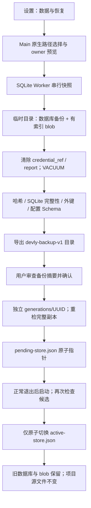

# 阶段 9：协议、恢复与稳定性

实施日期：2026-11-26。代码与本地验证范围为当前 macOS ARM64。用户确认 Responses/Anthropic 真实端点另行联调；本地协议服务不等于供应商实测。步骤状态见 [工作计划](./work-plan.md)，证据见 [工作日志](./work-log.md)。

## 协议与能力

Main 的 ProviderAdapter 工厂分别创建 Chat Completions、Responses 和 Anthropic Messages 适配器。共享网络传输与标准错误，原生消息、流式事件、工具 ID、结束标记和隐藏推理延续分别实现。业务组件只收到统一消息/工具/用量，不处理供应商专有字段。

- Responses 使用 input/output、function_call/call_id/function_call_output；加密推理项只在当前适配器实例内延续。
- Anthropic 使用 system/content blocks、tool_use/tool_result；保留当前实例的 thinking/signature，按块校验完整结束。
- 工具 JSON 完整且通过注册表校验后才执行；截断、重复 ID、未知服务端工具明确失败。不会自动改协议、供应商或重放副作用。
- 原生 fetch 的取消、超时和连接终止贯穿运行时。401、403、429、5xx、断流、取消分别记录；429 提供实际 Retry-After，用户决定何时重试。
- 能力未知保持 unknown；文本测试不能证明工具、视觉或结构化输出可用。模型列表接口缺失时手填 ID。

逐协议、端点、模型、日期与本地/真实证据见 [供应商矩阵](./provider-matrix.md)。三种协议均没有新增 SDK 依赖。

## 本地存储与备份

SQLite 仍为 v8，通过已有事务迁移、WAL 和独立 Worker 访问。逻辑根目录为 userData/storage，credentials 始终由 Main 的系统保护存储管理。恢复后数据库可位于独立 generation：

在“设置 → 数据与恢复”创建备份，或选择备份目录检查、审查后安排下次启动恢复。预览绑定窗口 owner、摘要和五分钟有效期；检查后文件改变会拒绝恢复。候选不可读/损坏时不覆盖当前数据；损坏存储指针有明确警告，不以空数据库代替可恢复的原库。连接失效时可显式“重新连接存储”，不会自动重放未确认的写入。

备份不是项目源代码目录的版本控制副本：只包含历史、设置、供应商元数据和有索引日志/附件。凭据密文目录、Key、诊断报告和凭据引用不导出；恢复后所有供应商 Key 需重新设置。历史和附件可能含私人项目内容，请妥善保存。原始迁移备份与便携备份目录是不同格式。

格式限制：devly-backup-v1、数据库 v8 起；数据库 256MiB、总量 512MiB、10000 个 blob、单 blob 8MiB。校验文件哈希、真实 SQLite 完整性/外键、配置与 Agent payload，并拒绝额外 trigger/view/virtual table。限额或错误不删当前数据。旧 generation 不自动清理，也没有自动回滚旧用户操作。未承诺任意断电或主机恶意程序场景的完整恢复。

安排恢复后暂停新消息；可取消待恢复操作继续，或正常退出并重新打开。备份后的其他本地元数据不在选定快照里，不应继续把它们当作已备份。

## 事件与中断核对

消息、回合、工具和审批变更，与单调 session sequence 事件在同一事务落库。事件 ID 与内容摘要核对：相同事件不重复写，变更重放拒绝，终态拒绝迟到覆盖。Renderer 不接受倒退序号。已接受的 turnId 不再发起第二次网络生成；这不等于网络 exactly-once 保证。

启动时旧活动回合标记中断、审批过期，旧命令进程状态标记 unknown。运行时连接丢失后的读取也会核对对应会话，避免永久显示生成中；不会因此改动另一个仍连接的会话。

历史中的“核对恢复状态”先检查：

| 检查 | 实际依据 | 不确定时 |
| --- | --- | --- |
| 历史 | 项目/会话/旧回合、事件序号 | 不跨会话恢复 |
| 审批 | 持久化审批及失效状态 | 旧授权不可复用 |
| 文件 | 已记录文件哈希与当前实际文件 | 变更/缺失/没有完整哈希分别提示 |
| 进程 | 旧命令记录与当前运行连接 | unknown，不宣称仍运行或已清理 |
| 模型 | 原 Provider/模型及配置 revision | 配置改变阻断继续 |

预览绑定 owner/token、两分钟有效期及检查摘要；确认前再次核对。确认后创建**全新回合**：项目任务只读复核，普通聊天按原绑定继续；不重放旧命令、文件补丁、审批或 HTTP，不恢复隐藏推理/旧子进程。后续写入须另发任务逐次审批。跨重启编辑器未保存草稿恢复仍未实现。

## 配置、诊断与秘密边界

“导出配置”生成 devly-config-v1：只含供应商名称/协议/地址/模型/兼容参数，以及应用默认偏好。数据库引用、Key、报告、历史和项目路径不在白名单。1MiB、最多 50 个供应商；严格拒绝未知凭据字段和明显密钥模式。它不能识别用户主动填入任意名称/路径的所有秘密，勿把凭据放入元数据。

“导入配置并审查”展示范围后再提交：所有供应商分配新 UUID，不覆盖旧配置或会话绑定，重映射应用默认值；替换应用偏好、清除未保存偏好草稿，项目覆盖保留。失败事务回滚，确认前不发 API 请求，导入后 Key 需重新设置。原先偏好组的“导出设置”仅为作用域 Settings JSON，不是完整配置导入格式。

“导出诊断”只导出版本、计数、状态和已知协议类别；不读取 Vault、不含日志正文/供应商名称/模型/URL/路径。原始工具日志继续通过受控历史入口按区间读取，保存前脱敏；被清理的日志明确不可用。

## 长会话与可操作错误

原 Message/Conversation/ScrollArea 保留；超过 60 条已加载消息时使用现有 TanStack Virtual 动态行高虚拟化，overscan=4。初次 20 条，逐页加载；上滚停止跟随，加载较早记录保留阅读锚点。只限制挂载 DOM，用户持续加载的历史数据仍会占用内存。

测量夹具为 2000 条约 16MiB 消息、1MiB 日志；日志每次最多读取 64KiB。实际窗口测量由 verify:performance-ui 输出 output/performance-stage9.json；时间是本机样例，不作为性能 SLA。开发与包内最终结果见日志。TanStack useVirtualizer 触发 React Compiler incompatible-library 提示，该 Hook 跳过自动 memo，不是运行失败。

未配置 API 提供配置入口；认证/权限/网络/限流失败可检查供应商；存储失败可重连或打开数据恢复；目录失效可重新选择；归档列表可恢复会话。错误不会自动转发上下文到其他供应商或后台重试工具。无法确认执行状态时保留 unknown。

## 验证入口

| 命令 | 覆盖范围 |
| --- | --- |
| pnpm check | 类型、Lint、154 项通过/3 项默认跳过、格式、文档、35 份原文件、构建与以下原生检查 |
| pnpm verify:stability | v7→v8、真实迁移失败回滚、快照、错误备份、事件重复/迟到保护 |
| pnpm verify:protocols | 两个新原生协议的真实回环 HTTP→搜索→读取→回答、对应调用 ID |
| pnpm verify:recovery | 重开 Worker、审批过期、实际文件变化、预览 owner/时效/重检、新只读回合 |
| pnpm verify:lifecycle | 三协议 × 8 项实际 HTTP 故障/超时/取消/关闭，单请求不重放 |
| pnpm verify:storage-faults | SQL 事务失败、真实 ENOTDIR、Worker 终止、坏指针与保留旧数据 |
| pnpm verify:configuration | 白名单、无 Vault 解密、预览归属/摘要、导入事务回滚及新 ID |
| pnpm verify:stability-ui | 实际 Electron：重连、原生协议配置聊天、恢复审查、导入导出、备份重启与异常入口 |
| pnpm verify:performance-ui | 实际 Electron：分页虚拟化、输入响应、有界日志读取与测量 |

GUI 脚本可通过 DEVLY_EXECUTABLE 指向已构建的未签名 Devly.app。临时生成项目/用户目录、回环服务与 fixture 模型，不使用个人 Key。实际磁盘耗尽、Windows、远端 CI、签名/公证/安装升级仍需对应条件；ANSI 组件完整上游版权通知等发行阻断保持记录。本阶段不展开 MCP、多 Agent 等阶段 10 工作。
