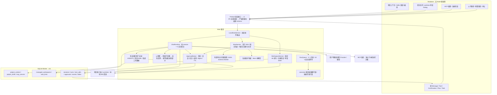
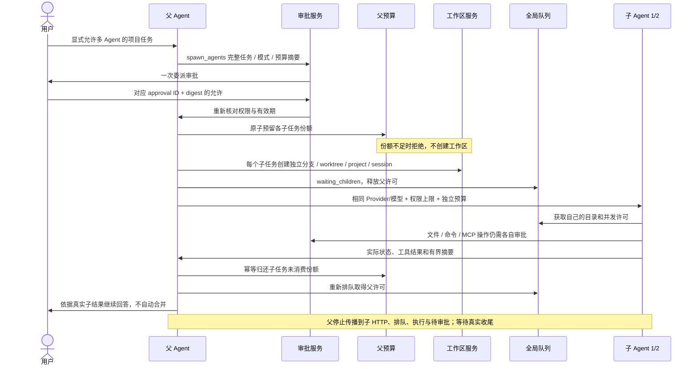
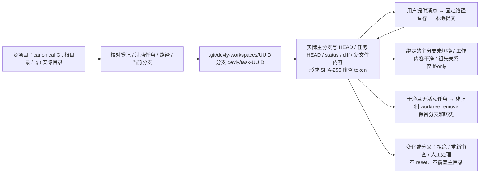

# 多任务、项目上下文、MCP 与 Skills

阶段 10 的实现与当前 macOS 验收范围。任务状态以 [工作计划](./work-plan.md) 为准，逐项证据见 [工作日志](./work-log.md) LOG-075 起。模型协议响应使用本地可复现夹具；MCP 服务、Git 工作区、文件、SQLite、窗口与审批均实际运行。没有新调用收费第三方模型，没有据此扩大供应商能力矩阵。

## 操作入口

设置按组独立显示，扩展四组都属于当前项目；没有项目时提示先打开项目，不把它们写到另一个项目。

| 分组 | 可以做什么 | 生效条件 |
| --- | --- | --- |
| 项目上下文 | 查看、新建、修改、启停、移除指令或记忆；设置目录范围 | 下一次 Agent 上下文组装；读取具体文件时补入适用的目录记录 |
| 任务与隔离 | 创建独立任务会话、选择当前目录或 worktree、查看队列、停止和打开任务、审查/提交/合并/关闭工作区 | 使用当前项目明确选择的 Provider/模型；创建 worktree 需要有提交的 Git 根仓库 |
| MCP 工具 | 配置 Streamable HTTP 服务、系统保护凭据、连接与工具发现测试、显式启用 | 项目 Agent 且权限为每次询问，每次调用都重新审批 |
| Skills | 扫描项目文件、查看原文、启用或移除 | 按已查看内容的哈希启用，下一次 Agent 加载；文件变化后重新审查 |

聊天输入区和任务创建表单的“多 Agent 委派”默认关闭。选择项目 Agent 后可显式允许模型提议子任务；这个选择只提供工具，不替代之后的委派审批和子任务各自的文件/命令审批。任务与子任务结果均可从历史打开。

## 运行架构与归属

每个回合都有自己的 projectId/sessionId/turnId；工具、日志和审批继续按这个三元组绑定。task_links 额外保存 rootTurnId、parentTurnId、workspaceId、contextProjectId 与预算/权限元数据。子任务通过 contextProjectId 继承根项目已启用的用户记录、Skill 和 MCP 配置，文件工具只针对自己的 workspaceProjectId。关系记录不授予新权限。

## 项目指令与记忆 A08

- 用户记录来源固定为 user，区分 instruction/memory，最多 50 条，每条内容不超过 8192 字符。根范围为 `.`，子目录范围不接受绝对路径、反斜杠或 `..`。
- 记录可查看、修改、停用、移除。没有模型自动写入记忆的工具，不将历史工具输出转为用户指令。
- 提示词明确当前请求、用户管理记录、适用 AGENTS、显式启用 Skill、普通历史与工具数据的来源和优先级；同类目录记录由宽到窄，读取文件时按实际路径加载。所有项目约定都不能扩展权限、批准操作或取得秘密。
- 上下文沿用 A05 的大小、Token 估算、摘要和输出限制；不是无限加载整个项目，也不改变会话 Provider 绑定。

## 队列与父子任务 I01/I06

- 全局最多 4 个活动回合、32 个活动及等待回合。重叠 canonical 目录的写任务按先后串行；被占用的目录不会阻止其他独立目录前进。只读任务可以与写任务并行，所以读取本身不代表文件快照隔离。
- 创建新任务建立新会话；同一会话仍只允许一个活动回合。取消排队项不会释放另一个运行任务的锁。回合计时包括排队，过期有实际状态。
- 最多两个子任务、只允许一层，不递归；仅显式选择的项目写任务可以提议。子任务不能选择其他供应商、任意目录或更大权限，根项目和子项目当前权限同时复核。
- Token 为可控的模型输出预算；每轮按剩余份额限制请求。供应商真实报告用量时扣实际输出，缺少用量时保守扣除预留输出；不是账户余额或硬性计费保证，供应商不遵守请求上限时不能保证费用上限。
- 调用次数、输出字符数和截止时间由父子共同分配；上下文/模型轮次各自还受不高于父任务的上限。预算面板是持久化快照，不声称跨重启仍在计时执行。
- 父任务等待子任务时让出许可，完成后再获取。子任务初始化部分失败时停止已启动部分，保留已经生成的工作区以便检查；没有自动删除分支、重放副作用或透明重启旧进程。

## worktree 创建、审查和合并 I02/I03

工作区来自已提交 HEAD；父任务本身在托管工作区时，子任务来自该工作区已提交 HEAD。未提交文件不隐式复制。创建操作不切换当前选中项目；进入任务由用户显式打开。工作区隔离只隔离文件修改，不等于操作系统沙箱，命令仍受已有 macOS 执行约束。

审查 token 包含主分支名称、主 HEAD、任务 HEAD、状态和实际差异；未跟踪新文件内容也参与。外部编辑或相同提交上的主分支切换都会使旧审查失效。当前仅允许快进合并；分叉/冲突要求人工解决，不提供自动 rebase/三路冲突编辑器，不推送。

补丁执行保留的 `.devly-before-UUID` 恢复副本不作为代码读取或暂存，审查界面显示数量。它们保留在工作区；关闭工作区前必须由用户手动妥善保存，存在副本时拒绝删除。其他受保护/秘密路径不因审查而放宽。最多 200 条变更、返回 Diff 最多 100000 字符；超过范围拒绝或明确只展示有界内容，不能宣称任意大仓库全部可审查。

任务工作区在源 `.git` 下，普通编辑器 Git 服务的任意外部 metadata 访问没有放宽。托管工作区的提交、审查和合并通过源项目专用服务完成；不要把它理解为任意外部 worktree 的完整通用 Git 客户端。最多保留 100 条工作区元数据，包含已关闭项；到上限明确拒绝，没有自动删历史的策略。

关闭后保留项目/会话/回合数据和分支，可打开历史；目录失效时不能发起旧目录工具任务。重新打开界面或重启只恢复持久状态，不重连旧模型请求、不重新批准旧按钮、不自动重放写入。

## MCP I04

采用官方 `@modelcontextprotocol/client@2.4.0`，本地验收服务用官方 `@modelcontextprotocol/server@2.4.0`。当前只支持 Streamable HTTP：HTTPS 或 literal 回环 `127.0.0.1`/`[::1]` 的 HTTP；不接受地址凭据、查询串、片段或跨地址重定向。当前 SDK 默认兼容握手，不声称已覆盖所有最新 MCP 协议扩展。

| 环节 | 实际行为 |
| --- | --- |
| 保存与凭据 | 每项目最多 10 个服务；DB 保存引用，Main/Vault 持有秘密，系统保护输入框设置/清除；保存返回值无 Key |
| 测试 | 建立真实连接、读取工具、关闭；“连接与工具发现成功”不等于长期在线或工具执行成功 |
| 注册 | 仅项目写模式且明确启用的服务；每回合最多 4 个服务/20 个工具，总连接最多 16，超限明确说明 |
| 别名 | 服务 UUID + 工具名哈希生成 alias，同名服务工具不冲突；UI 保留真实服务、URL、工具、Schema 来源 |
| 参数 | Schema 最多 16 KiB、参数最多 8192 字符；Ajv 在独立 Worker 校验，2 秒/64 MiB 限制；不任意拉取外部 Schema |
| 审批 | 注册配置 revision、Schema 哈希在审批前后复核；每次调用都要对应项目/会话/回合/调用/ID/digest/有效期 |
| 返回 | 网络消息有界、工具输出最多 262144 字符，结构化输出按已声明 Schema 校验；服务 isError 与调用异常区分 |
| 取消/断连 | 已派发的外部操作无法证明回滚，记录 EXECUTION_STATE_UNKNOWN；撤销旧审批，不自动重试副作用 |
| 清理 | 回合结束关闭连接，配置/凭据变更清除对应连接；描述、参数和结果始终是不可信数据 |

MCP 服务可能访问远端文件、账户或网络，不能用本机项目沙箱来保证服务行为。暂不开放 stdio、任意本地服务进程、OAuth、sampling、elicitation、资源/提示词全家桶或所有第三方扩展。非文本/不支持协议场景需要另行适配，不猜测执行成功。

## Skills I05

发现位置：`.agents/skills/<名称>/SKILL.md`、`.claude/skills/<名称>/SKILL.md`、`.devly/skills/<名称>/SKILL.md`。最多发现 32 个，最多启用 8 个；文档最多 16 KiB。名称路径、每层真实目录、文件编码和秘密内容均有检查，不跟随符号链接。最小 frontmatter 支持单行 name/description，其他原文仍可查看，但不声称完整 YAML/所有 Skill 方言兼容。

启用保存 path/hash。任务开始再次读取并比对，变化或丢失时提示设置 → Skills 重新查看启用或移除。注册的 `read_skill_resource` 只读取已经启用的 Skill 目录，最多 300 行、拒绝越界/秘密/二进制等，返回真实行号和内容版本。相关脚本仅是文件；没有因为 Skill 提到脚本就自动执行，仍须经正常工具与审批。

## 数据、迁移与备份

| 版本 | 新增数据 | 保护 |
| --- | --- | --- |
| v9 | project_context | 项目归属、严格来源/目录/内容限制 |
| v10 | managed_workspaces、task_links | 独立项目/父子/根回合关系，保留关闭后的历史 |
| v11 | mcp_servers、project_skills | 配置 revision、受保护凭据引用、所选文档内容哈希 |

迁移追加到已有事务迁移链，旧版本备份可检查并在恢复启动后升级。v11 快照剥离 MCP 和模型凭据引用后 VACUUM，活动库引用保留；恢复后凭据需重新设置。验证快照时校验记录 Schema 和列/JSON 归属，禁止可执行 trigger/view 等。

备份保存数据库、日志索引及已有 blob，不复制项目源目录、worktree 文件、分支、SKILL.md 或资源内容。恢复任务元数据不是恢复文件快照，更不是证明旧命令仍运行；使用前仍核对真实目录/Git/内容，不能凭缓存允许旧审批。便携配置 JSON v1 仍为既有 Provider 与应用偏好白名单，不宣称已经导出所有项目扩展配置。

## 检查与边界

| 命令 | 实际范围 |
| --- | --- |
| `pnpm check` | 类型/Lint/格式、单测、来源、构建、既有集成，以及 verify:extensions/skills |
| `pnpm verify:extensions` | 真实用户记忆上下文、来源、两个项目隔离、Worker 重开/移除 |
| `pnpm verify:workspaces` | 临时真实 Git、两工作区、分支绑定、外部修改、脏内容保护、提交/快进/分叉/关闭 |
| `pnpm verify:mcp` | 官方 SDK 的实际 HTTP MCP 服务、成功/失败、别名、Key 引用、审批/参数/服务错误/派发后取消 |
| `pnpm verify:skills` | 实际 SKILL.md/资源、Agent 工具往返、内容变化/越界/符号链接拒绝 |
| `pnpm verify:multitask` | 两个隔离子任务、继承和预算、真实文件审批、父子取消、同目录排队/异目录并发、日志归属 |
| `pnpm verify:extensions-ui` | 实际表单/原 Confirmation、真实 MCP/Skill/父子任务、Diff 审查/提交/快进、最小窗口和重启；支持 DEVLY_EXECUTABLE 包内复核 |

这些检查只使用临时项目、生成的测试凭据和本地模型夹具，不能代替新供应商真实联调。macOS 当前验证不代替 Windows、远端 CI、任意外部 MCP、任意 Skill 或收费模型的多 Agent 行为；正式发行的依赖维护、版权通知、签名和安装包门槛继续保留。操作证据和失败修正均写入工作日志，不以脚本存在声称已经通过。

主要代码：src/main/extensions、src/main/chat/runtime.ts、src/shared/extension-contracts.ts、src/renderer/src/features/extensions；UI 继续复用已有 shadcn/Radix 和原 AI Elements，没有新增另一套控件库。

官方参考：[TypeScript SDK](https://github.com/modelcontextprotocol/typescript-sdk)、[MCP 传输规范](https://modelcontextprotocol.io/specification/2025-11-25/basic/transports)。依赖许可证和来源见 [依赖评估](./dependency-review.md)。
