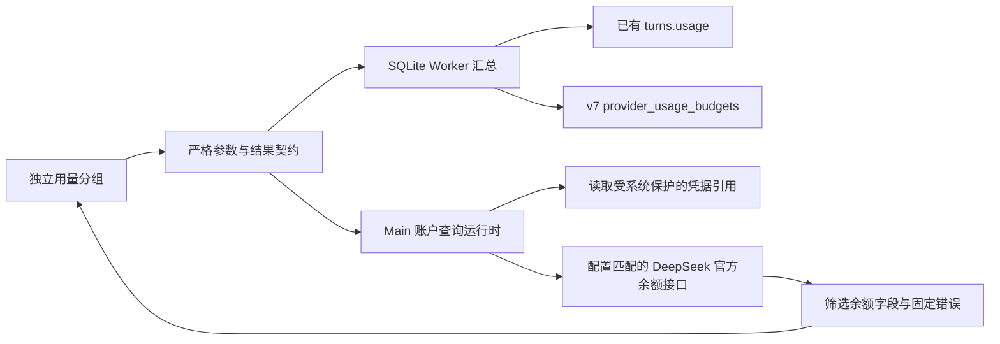

# Token 用量与账户额度

入口：**设置 → 用量与额度**。选择已保存的供应商，查看本机已用 Token、设置本地预算，或查询已支持服务的账户余额。此分组独立显示，不混入其他设置。

## 两种口径

| 项目 | 数据来源 | 范围 |
| --- | --- | --- |
| 输入、输出、累计 Token | API 响应的 usage，经聊天/Agent 归一化后保存在 turns.usage | 本机当前供应商记录的所有模型、历史配置和已结束回合，包括失败或取消时已收到的用量 |
| 本地预算剩余 | 用户预算减去统计期间已确认的 totalTokens | 本地提醒，不是供应商账户余额，不阻止发起请求 |
| 账户余额 | 用户点击后，在 Main 使用已保存 Key 调用支持的账户接口 | 当前密钥对应的供应商账户；可能包含其他应用/设备的消费 |

本地用量不含连接测试、其他应用、其他设备或尚未结束的回合。回合数不是 HTTP 请求数：Agent 一个回合可以调用模型多次。现有 Agent 回合汇总中任一轮缺少某项 usage，该项可为空；本页不反推缺失数值，也不补造单请求账本。历史更换 Key 或地址后仍按原供应商记录 ID 归集；新账户可手动重新计数预算。

- 没有回合时显示 0。API 明确上报 0 仍算已上报；缺失值显示“未上报”。
- 部分回合未上报时，累计量用“≥”标为已确认下限，并显示上报回合覆盖数。
- 缺失用量或仍有运行中的回合时，剩余标为“至多”，不冒充精确账单。
- 上报完整时，剩余为预算减累计量，下限为 0；超过预算另外显示已确认超额。
- 如供应商支持，在“模型供应商 → 兼容参数”开启流式用量上报；不自动修改所有端点的兼容配置。
- 点击“刷新用量”获取新的本地统计。账户余额仅手动查询，不在后台轮询。

## 预算操作

每个供应商独立保存预算。默认统计全部历史，可填写 0 到 1,000,000,000,000 的整数；留空再保存表示取消预算。保存不会改变已有统计起点。

“保存并从现在重新计数”将当前预算与新的本机时间一起保存，之后只统计起点后开始的回合；不删除消息、回合或历史用量。运行中但在起点前开始的回合不计入新期间。供应商预算与起点重启后保留；预算不属于项目偏好，不进入设置导出。移除供应商时只清除其预算，保留历史回合。

## 账户接口支持

| 配置的实际端点 | 当前能力 | 不能声称的内容 |
| --- | --- | --- |
| HTTPS api.deepseek.com，根路径或 /v1 | 手动 GET /user/balance，展示 CNY/USD 可用余额、赠送和充值余额、查询时间及是否可用 | 接口没有账户已用/剩余 Token，不把金额转换为 Token |
| 火山方舟 ark.*.volces.com | 显示管理鉴权说明，本地用量/预算照常可用 | 不用推理 Key 冒充 Access Key，不因为模型名含 DeepSeek 而查询 DeepSeek 官方账户 |
| 其他域名或代理 | 明确显示账户额度查询暂未接入 | OpenAI 兼容协议没有统一账户余额接口，不猜测代理的私有路径 |

依据：[DeepSeek 官方余额接口](https://api-docs.deepseek.com/api/get-user-balance/)、[火山方舟管理用量接口鉴权](https://docs.volcengine.com/docs/ark/get-inference-request-usage-api?lang=zh)。本次没有新增火山管理 Access Key 输入或资源包查询适配器；其账户剩余额度仍需在控制台查看。新增其他账户适配器需要各平台文档与单独验收。

## 数据与请求路径

- SQLite v7 先备份、事务迁移；新增预算表与 provider_id/started_at 索引。Worker 中执行聚合，Renderer 不加载完整会话日志。
- IPC：usage.summary、usage.budget.save、usage.account、usage.account.cancel。Renderer 不能指定查询 URL、Header 或 Key。
- 账户请求禁止跳转，仅允许匹配的官方 HTTPS 服务，10 秒超时、64 KiB 输出上限；每窗口一个并发、全局最多四个。401/403/429/5xx、超时、取消、配置变化分别归一化；原始错误体和未知字段不返回界面或日志。
- 切换供应商、离开用量组、关闭窗口，以及配置/密钥修改会取消对应查询或阻止旧结果发布；取消按窗口与供应商归属检查。返回前重新核对 revision 和凭据引用。
- 页面使用现有 shadcn/ui Button/Input/Label/Select 与 AppShell ScrollArea，不增加页面滚动容器或依赖。

## 验证与边界

- pnpm test：新增账户来源识别、鉴权错误、超时/取消、配置变更、响应限额、IPC 边界与预算下限测试。
- pnpm verify:data：真实 SQLite Worker 检查汇总、缺失/零值、预算拒绝、供应商隔离、重启与重新计数、移除预算但保留回合。
- pnpm verify:usage-ui：隔离 Electron + 两次 loopback 聊天，一次上报用量、一次缺失，验证预算、超额、重启、供应商切换、账户能力提示和小窗口边界；截图位于 output/usage-*.png，为测试数据。
- pnpm verify:desktop：六个设置分类仍只显示当前一组。

没有使用真实 DeepSeek 官方密钥做账户查询验收；单元测试注入的余额不代表真实账户额度。火山方舟现有真实聊天验收也不等于其管理额度接口已接通。其他系统、签名与正式发行状态不随本次本机验证改变。详细结果见 LOG-045。

## 阶段 6 的回合显示

Agent 展示包含工具定义的本次序列化上下文粗略估算（字符数 / 3）；仅配置 contextWindow 时计算占比，绝不当作准确 tokenizer 用量或费用。已上报 Token 继续来自供应商；费用未知时明确标注未计价。maxCost 为偏好，当前不保证美元硬停止。详见 execution-foundation.md；此前账户接口覆盖范围不扩大。
