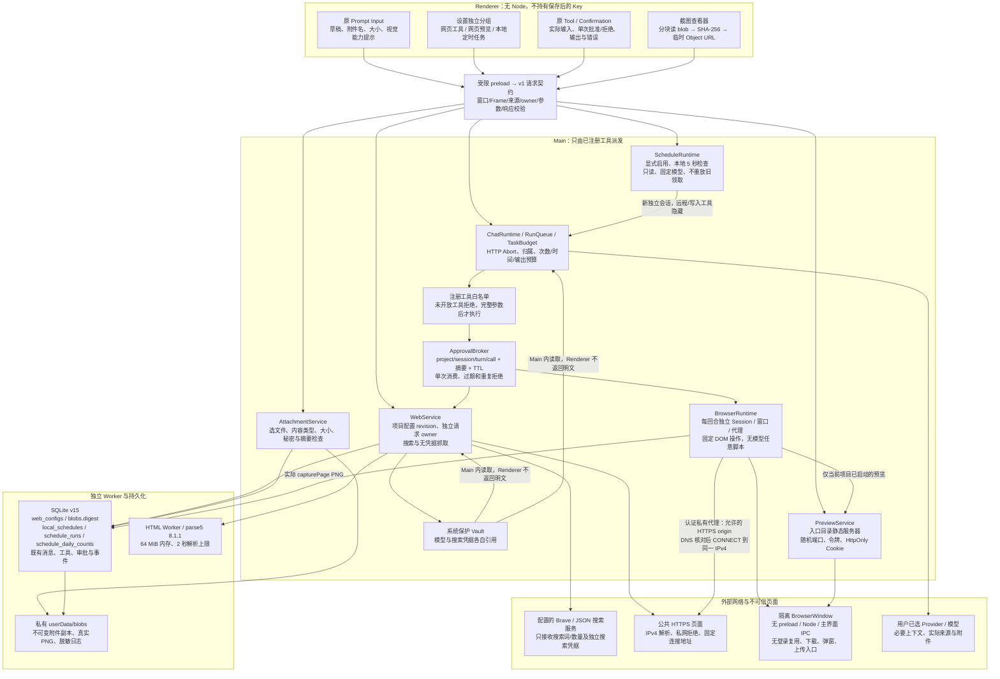
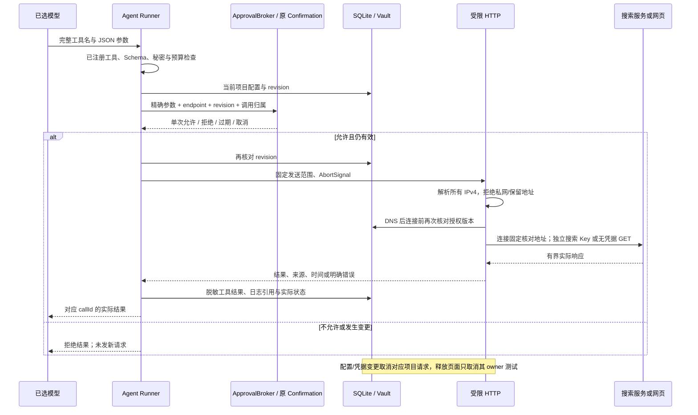
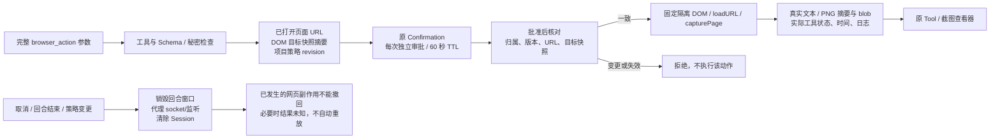

# 附件、网页与本地自动化

更新：2026-11-27。对应阶段 11：E01/E02/E03/T10/E04/E05/E06。任务状态以 [工作计划](./work-plan.md) 为准，证据与失败记录见 [工作日志](./work-log.md) LOG-083 起。搜索真实端点由用户明确留待后续联调；本地模型响应不能替代真实供应商验收。

## 运行架构与信任边界



网页正文、搜索摘要、DOM、MCP 和 Skill 资源是带来源的数据，不授予新权限。工具白名单在参数派发之前检查，模型不能通过猜测隐藏工具名绕过当前任务策略。网页权限与项目写权限独立；只读 Agent 只有在用户明确开启网页能力且逐次批准后才能使用对应工具。本地定时任务进一步隐藏所有网页、浏览器、MCP、命令、写入及子 Agent 工具。

## 搜索与抓取

先打开项目，在设置 → 网页工具中独立启用搜索或抓取。默认关闭。Brave 选择固定搜索 API 和系统保护凭据；JSON 服务接收 GET 查询参数 q/count，返回如下结构：

```json
{"results":[{"title":"来源标题","url":"https://example.org/page","excerpt":"实际摘要"}]}
```

JSON 服务有凭据时使用 Authorization: Bearer，Brave 使用 X-Subscription-Token。凭据输入沿用 Main 系统安全输入框，数据库只保存受保护引用。搜索测试按钮先保存当前配置，再仅向搜索端点发送用户填写的测试词；无结果明确为空，不生成替代搜索结果。测试不自动向模型转发项目。

Agent 提议 web_search 或 fetch_url 时，原 Confirmation 显示完整搜索词或目标 URL，每次必须单独批准。返回实际 URL、标题/摘要、取得时间及截断状态。正文通过无 Cookie/无 Key GET 获取，只有成功取得的内容才作为工具数据交给本回合已选模型；拒绝、认证、限流、格式错误和网络失败均返回实际失败，不自动重试。



| 边界 | 当前实现 |
| --- | --- |
| 抓取目标 | 公共 IPv4 HTTPS/443；拒绝私网、元数据、凭据 URL、IPv6与特殊端口 |
| 搜索目标 | 固定配置 HTTPS；开发/自托管可明确使用字面量 127.0.0.1 HTTP |
| 重定向 | 抓取最多三次且同来源，跨来源必须新请求/审批 |
| 网络上限 | 每响应 2 MiB、DNS 5 秒、socket 15 秒、总请求 20 秒、最多 16 个请求 |
| 正文 | UTF-8 HTML/text；parse5 Worker 去脚本/样式等，摘要最多 12000 字符 |
| 搜索 | 搜索词最多 600 字符、请求最多 10 个来源；来源不是访问成功证明 |
| 撤销 | 配置与凭据更新撤销旧请求；已传出的数据/已计费请求不能追回 |

公开 HTTPS 抓取和浏览器导航有实际样例，本地搜索响应有可复现测试；没有真实 Brave 或用户自定义商业搜索服务验收。当前不支持任意代理、IPv6、登录网站或所有复杂动态站点，不把这层网络策略称为 OS 沙箱。

## 图片与文件附件

输入框的添加附件按钮通过系统选择器导入本地副本。导入不发网络；发送前保留草稿、展示名称/类型/大小与传输提示，可仅移除待发送引用，不修改或删除原文件。直接拖入/粘贴文件不绕过该入口。

- 文本：明确扩展名的 UTF-8 源码/文档，最大 128 KiB；无效编码、NUL、秘密文件/凭据内容拒绝。
- 图片：PNG/JPEG/WebP，最大 2 MiB，尺寸最大 8192、总像素最大 1600 万，核对扩展名/头部/尺寸；不是独立完整解码或恶意图像安全证明。
- 每次最多 4 个；blob 总量上限 256 MiB。PDF、压缩包等不在当前支持范围。
- 每个副本持久化 MIME、字节数及 SHA-256，按项目/会话校验，读时重新核对；缺旧摘要、外部篡改或跨会话引用会在发送前拒绝。
- 消息分段引用实际 blob，已被消息引用的副本不能随意删除。备份核对 blob manifest 与附件摘要；未引用副本受既有保留/总量规则控制。

视觉未知或不支持的模型不能发送图片，界面提供移除或选择支持模型的下一步；不能在模型切换后静默丢弃图片历史。历史只恢复已完成消息的真实附件；再次发送会按当前显式选择的 Provider 发送该会话上下文，不跨供应商自动转发。

Chat Completions 使用 image_url，Responses 使用 input_image，Anthropic 使用 base64 source/media_type/data，各协议独立映射。图片上下文按明确字符占位估算；实际 Token 沿用供应商上报，不编造图片用量和价格。本轮只用本地协议夹具检查传输与能力门控，没有新增真实视觉模型验收。

## 隔离静态网页预览

设置 → 网页预览输入项目内 HTML 路径，明确启动后打开独立窗口。可预览 index.html、dist/index.html 等已有静态构建产物，不自动运行 npm、Shell 或任意服务器。入口所在目录是静态根，根外路径、符号/硬链接、受保护文件和秘密内容拒绝，资源最多 2 MiB、类型有白名单。

每次启动创建 127.0.0.1 随机端口，随机初始路径令牌换取 HttpOnly/SameSite Cookie 后重定向到实际入口。没有 Cookie 的直接请求拒绝；检查 Host，页面不可读取授权 Cookie。URL/端口不是稳定的后台服务 API。

独立非持久 Session，sandbox/contextIsolation 开启，无 preload、Node、主界面 IPC 或 opener；禁止权限、显示媒体、下载、弹窗和 webview。CSP 限制外连、表单、iframe、Worker 等，页面只可请求当前预览来源。因此不支持 HMR、外部 CDN、后端 API 或登录流程。它是受限网页容器，不是 VM/完整 OS 隔离。

停止、关闭预览窗口、主界面重载、所有者释放或退出应用，关闭窗口、监听和已有连接并清除 Session 数据。旧端口/PID 不保存为仍在运行。

## 审批式浏览器自动化

网页工具组单独启用浏览器，并填写最多八个精确 HTTPS origin，例如 https://example.org。每回合创建独立非持久 Session/窗口/认证代理，不共享主界面登录、父子回合或其他任务的 Cookie。

| 动作 | 执行方式与限制 |
| --- | --- |
| open_preview | 仅当前实际工作项目已启动的隔离静态预览；不能任填 localhost 端口 |
| open_url | 仅显式配置的 HTTPS origin；代理解析并固定实际公共 IPv4，再建立 CONNECT |
| read_text | 固定隔离世界脚本，返回实际 URL/标题/正文与截断标记 |
| screenshot | 实际 capturePage PNG，归属当前运行工具及 assistant 消息；最多四张/回合 |
| click/fill | 固定选择器操作，拒绝密码/文件输入；审批前快照，执行时原子比较目标，变化则拒绝 |
| close | 关闭当前回合浏览器、代理及 Session；同样按明确调用归属记录 |



无任意 JS、上传、密码填入、下载、弹窗或网站登录复用入口。文件选择对话框在隐藏窗口加载后由 CDP 拦截，再显示窗口；自动化 click/fill 还单独拒绝文件/密码目标。页面仍可在用户批准点击后产生网站副作用，取消不能保证远端操作未发生。每动作 20 秒，代理 16 MiB 总流量、16 socket 限额；超过边界明确失败。

截图只作为真实本地审查产物，界面分块读取并校验 SHA-256 后显示，不自动送到模型视觉接口，也不声称模型已看到图片。实际 PNG 可能包含用户所浏览页面内容，截图审批应检查该页面范围。

## 本地定时任务

设置 → 本地定时任务，输入只读任务、固定供应商和模型、间隔/错过策略/每日上限。默认停用；只有显式选择同意自动执行并保存或点击启用后，后续才会发送模型请求。可修改、执行一次、停止并停用、查看最近 30 条记录、定位会话或移除任务；移除记录不删除项目原文件。

| 项目 | 当前约束 |
| --- | --- |
| 调度 | Main 进程内每 5 秒检查，无常驻 daemon/云端；退出不执行，macOS 仅关闭窗口而应用仍在运行时可继续 |
| 数量 | 每项目 10、全局 100，最多四个活动任务，共享既有 RunQueue；每任务保留最近 300 条运行索引，界面分页摘要最多 30 条 |
| 间隔 | 60 秒到 30 天；保存/修改会重新安排下一时间 |
| 错过 | 延迟超过 30 秒为错过；跳过，或恢复最多补一次，不补跑全部周期 |
| 每日限额 | 按 UTC 日期 1–20 次，默认 5，手动“执行一次”也计数；每日计数独立持久化，不因运行索引保留清理而重置；不是供应商账户预算 |
| 单次预算 | 最多 2048 输出 Token、6 工具、4 轮、30 秒、16384 工具输出字符、24000 上下文字符；项目更低上限继续生效 |
| 权限 | 只读项目工具，关闭命令、写入、MCP、网页/浏览器、子 Agent；伪造隐藏工具也拒绝 |
| 会话 | 每次独立记录，固定已选 Provider/模型，无自动切换，不改变用户手动选中会话 |
| 停止 | 先停用，再取消该任务并等待 HTTP/回合清理；不取消其他手动会话 |
| 睡眠 | powerMonitor suspend 停止当前任务，resume 遵守错过策略；物理睡眠仍需用户环境验证 |
| 重启 | 旧 claimed/running 记录为 interrupted；不重放旧 HTTP，不把缓存状态当继续运行 |
| 恢复 | 去秘密备份中所有任务停用；有启用任务的外部备份拒绝，恢复后需明确重新启用 |
| 通知 | 默认关闭，显式开启后仅系统完成/失败通知，不含任务名/内容；系统通知权限由 OS 控制 |

领取、推进下次时间与写入运行记录在 SQLite Worker 事务内完成；会话及 running 关联先持久化，再调用模型。应用在领取后崩溃，重启记中断而不是重新发送。网络失败/认证/限额/目录失效生成实际失败记录，不自动重试同一运行。必要项目内容依然可能发送给模型并计费，不能把只读理解为离线或免费。

## 检查入口与实际验证范围

| 命令 | 验证内容 |
| --- | --- |
| pnpm verify:web | 实际本地 HTTP 搜索、凭据引用/脱敏、来源、401/429、审批/撤销/owner 隔离 |
| pnpm verify:attachments | 真实文件导入、持久引用、三协议传输/历史、能力拒绝/篡改/归属 |
| pnpm verify:preview-ui | 实际 HTML/CSS/DOM、无 IPC、Cookie、越界/秘密拒绝、端口停止/重载 |
| pnpm verify:browser-proxy | 实际认证 HTTP/CONNECT、私网/未知来源拒绝、关闭不可连接 |
| pnpm verify:browser-ui | 实际窗口六次审批、DOM 变化拒绝、PNG/查看、停止与旧审批 |
| pnpm verify:schedules | 真实 SQLite/HTTP/读文件、预算/限额、取消隔离、重启和停用备份 |
| pnpm verify:stage11-ui | 原输入框附件、视觉限制、独立设置组、实际运行记录及应用重启 |
| pnpm verify:worker-close | 三个独立 Electron 进程，各四次 SQLite Worker 自然退出与并发关闭 |
| pnpm verify:stage11-suite | 顺序运行前三项桌面扩展与审批/编辑器/任务扩展/恢复回归；DEVLY_EXECUTABLE 可指向未签名应用 |
| pnpm check | 类型/Lint/格式/单测/文档/来源/构建与全部已接入本地集成；GUI 与包内另验 |

公网样例脚本只在明确执行时使用公开页面，不纳入 CI 反复依赖外站。真实搜索、新协议真实端点、真实视觉模型、实际睡眠/通知、Windows、外部复杂网页和完整 OS 网络隔离均不能从本地夹具推导通过。当前 macOS 包内及最终全套结果见阶段 11 最终日志；未签名 .app 目录不等于正式安装包或跨平台发行。

实现参考：[Electron Session](https://www.electronjs.org/docs/latest/api/session)、[Electron WebContents](https://www.electronjs.org/docs/latest/api/web-contents)、[Brave Search API](https://api-dashboard.search.brave.com/app/documentation/web-search)、[Anthropic Vision](https://platform.claude.com/docs/en/build-with-claude/vision)。锁定代码与许可证以本仓库实际安装内容为准。

文件选择拦截先显式启用 Page 事件通知，再配置拦截；实际可信点击触发事件、空文件列表与受保护选择器拒绝的检查见最终日志。参考：[Chrome DevTools Page 协议](https://chromedevtools.github.io/devtools-protocol/tot/Page/)。
